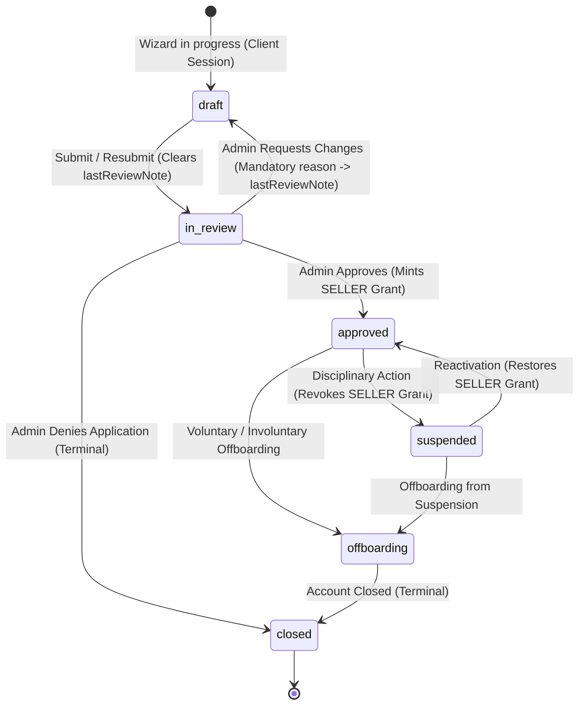

# 05 — Features: Seller

Status: ACTIVE (Phase 1: Onboarding & Shop Setup; Phase 2: Transactional & KYC Deferred)  
Related: `03-users-and-rbac.md`, `06-features-admin.md`, `07-data-model.md`, `12-cart-checkout-orders.md`, `13-payments-and-payouts.md`

---

## 1. Onboarding & Verification

### Phase 1 (Active) vs. Phase 2 (Deferred) Scope Partition

- **Phase 1 (Active — Current Implementation)**:
  - Seller portal onboarding gate in `apps/seller` (`/[locale]/onboarding`).
  - 3-step registration wizard: Legal Entity details, Shop profile with live debounced slug uniqueness validation, and Review & Submit.
  - Client-side form persistence (scoped to authenticated `accountId`), with zero DB writes or slug claims until the final "Submit Application" action.
  - Atomic backend creation at `draft` followed immediately by the guarded transition to `in_review` via the single state transition choke point.
  - Reviewer feedback loop: "Changes Requested" (`in_review -> draft`) persists mandatory feedback in `Seller.lastReviewNote`, displayed prominently in the portal with resubmission support (`draft -> in_review`).
  - Pure RBAC grant invariant: `Grant { role: 'SELLER', scopeType: 'seller', scopeId: seller.id }` exists if and only if `status === 'approved'`.
  - Active shop management: Storefront profile editing (display name, description, branding) and vacation mode toggle (`vacationUntil`).
- **Phase 2 (Deferred — Public Launch Gate)**:
  - KYC document upload and identity verification queue (government ID, business certificate, tax registration).
  - Payout bank account routing and micro-deposit confirmation.
  - Multi-warehouse inventory origin addresses.
  - Formal legal agreement versioning and re-acceptance workflows.

---

### Onboarding State Machine & Lifecycle Invariants

The seller onboarding lifecycle operates strictly within the real 6-state `SellerStatus` enum (`draft`, `in_review`, `approved`, `suspended`, `offboarding`, `closed`) defined in PostgreSQL schema and `@shopnetic/contracts`:



#### Core Architectural Invariants

1. **No Orphaned Drafts in DB**:
   Unsubmitted wizard attempts remain strictly in client-side form state (backed by `sessionStorage` scoped by `accountId`). No DB rows or shop slug claims are created until the final "Submit Application" click, preventing abandoned attempts from clobbering shop slugs or creating DB clutter.
2. **Guarded Registration Choke Point**:
   `POST /seller/v1/register` creates the `Seller` with `status: 'draft'` and associated `Shop`, then immediately executes the internal guarded transition to `in_review` within the same atomic `prisma.$transaction`. This ensures `VALID_SELLER_STATUS_TRANSITIONS` remains the single enforced gate for every status change in the system, writing accurate `seller.created` and `seller.status_changed` outbox events.
3. **Single Source of Truth for Reason-Required Transitions (`REASON_REQUIRED_SELLER_STATUSES`)**:
   Enforced via a single shared constant in `@shopnetic/contracts` used by contract validation, backend service validation, and admin UI:
   ```ts
   export const REASON_REQUIRED_SELLER_STATUSES: readonly SellerStatus[] = [
     'draft',       // Changes requested by reviewer
     'suspended',   // Disciplinary suspension
     'offboarding', // Disciplinary or voluntary offboarding
     'closed',      // Denial or permanent account closure
   ] as const;
   ```
4. **Applicant Feedback Channel & Clear-on-Resubmit (`lastReviewNote`)**:
   When staff requests changes (`in_review -> draft`), the mandatory review reason is persisted to `Seller.lastReviewNote`. When the seller resubmits (`draft -> in_review`), `lastReviewNote` is automatically cleared back to `null` within the transition transaction so that stale reviewer notes never linger. When the seller visits the portal while in `draft` with an active note, `GET /seller/v1/me` exposes `lastReviewNote`, displaying a localized callout explaining the reviewer's feedback and allowing the seller to adjust and resubmit.
5. **Pure RBAC Grant Invariant**:
   A `Grant` with `Role.SELLER` (`scopeType: 'seller', scopeId: seller.id`) exists if and only if `status === 'approved'`. On every transition, the grant is recomputed: upserted on `approved`, and purged on any other status (`draft`, `in_review`, `suspended`, `offboarding`, `closed`).
6. **Reapplication Boundary**:
   - Fixable applications transition `in_review -> draft` ("Changes Requested"), allowing the applicant to correct their information and resubmit.
   - Fraudulent or banned applicants transition `in_review -> closed` ("Denied"). Because `closed` has zero outgoing transitions and `Seller.accountId` is unique, closed accounts are permanently barred from selling.

---

### Onboarding Steps

| Step | Scope | Notes / Edge Cases |
|------|-------|--------------------|
| **1. Authenticate & Onboarding Gate** | Phase 1 | Authenticated marketplace account (`plane: 'marketplace'`). If `GET /seller/v1/me` returns `null`, user is routed to `/onboarding`. |
| **2. Legal Entity Details** | Phase 1 | Collects `legalName`, entity `type` (`business` vs. `individual`), and 2-letter ISO `country` code. |
| **3. Shop Profile & Slug** | Phase 1 | `displayName`, `slug` with live debounced uniqueness check (`GET /seller/v1/shops/check-slug`), `description`, and optional `logoUrl` / `bannerUrl`. |
| **4. Review & Submit Application** | Phase 1 | Summary review; atomic submit creates `draft` and transitions to `in_review`, writing outbox events and audit log. |
| **5. Application Under Review** | Phase 1 | Displays pending review screen while awaiting staff moderation in Admin panel. Read-only view with support guidance. |
| **6. Changes Requested & Resubmission** | Phase 1 | If staff transitions `in_review -> draft`, displays prominent alert with `lastReviewNote`. Seller updates form and clicks "Resubmit Application" (`draft -> in_review`). |
| **7. Approval & Grant Minting** | Phase 1 | Staff approves in admin; `SellerService.updateStatus` mints `SELLER` grant; seller gains immediate access to active shop dashboard. |
| **8. KYC & Identity Documents** | Phase 2 | Government ID, business registration certificate, tax ID proof. Upload to secure storage and review queue. |
| **9. Bank & Payout Details** | Phase 2 | Bank routing, IBAN, micro-deposit verification. |

---

## 2. Shop Management

- **Storefront Profile & Branding**: Edit display name, description, logo URL, banner URL via `PATCH /seller/v1/me/shop`.
- **Vacation Mode (`vacationUntil`)**: Date picker to pause buyer orders temporarily without de-listing products.
- **Ownership Scoping**: All mutations require `assertCan(actor, Permission.SHOP_MANAGE, { sellerId })`, ensuring sellers can only modify their own shop.
- **Policies (Phase 2)**: Shipping zones, return windows, cancellation rules, warranty terms.
- **Multi-Warehouse Shipping (Phase 2)**: Origin addresses and warehouse assignments.
- **Team Members (Phase 3)**: Sub-users with scoped seller permissions (`staff` role scoped to `seller:{id}`).

---

## 3. Catalog & Offers

| Feature | Notes / Edge Cases |
|---------|--------------------|
| **Find/attach to existing product** | Search catalog; if product exists, create an **offer** (price, condition, stock, handling time). Prevents duplicate catalog entries. |
| **Propose new product** | If not in catalog: submit product data + images → Catalog moderation queue. Approved → becomes base product; seller's offer attaches. |
| **Variants** | Define/choose variant axes (size, color…). Stock + price per SKU. |
| **Media** | Images (min/max dimensions, no watermarks), alt text, ordering; optional video. |
| **Pricing** | Base price, sale price + schedule, MSRP/compare-at, min-order-qty, max-per-order. |
| **Inventory** | Per SKU per warehouse. Safety stock, backorder toggle, restock date. Low-stock alerts. |
| **Bulk ops** | CSV/XLSX import & export, template download, dry-run with row-level errors, async job with progress + report. |
| **Offer status** | `active / paused / out_of_stock / under_review / suppressed`. |
| **Buy-box / ranking hints** | Explain why an offer isn't winning (price, rating, handling time, cancellation rate). |

---

## 4. Order Fulfilment

| Feature | Notes / Edge Cases |
|---------|--------------------|
| **Sub-order queue** | Filter by status, SLA countdown (handling-time breach highlighted). |
| **Accept / confirm** | Optional auto-accept. Reject with reason → refund saga for that sub-order. |
| **Pack & ship** | Mark packed → shipped; enter carrier + tracking (or buy label via Shipping integration). Print packing slip / invoice. |
| **Partial shipment** | Ship available items now, rest later; each shipment tracked separately. |
| **Cancellations** | Buyer-initiated (pre-ship) auto-approved; seller-initiated needs reason; both trigger refund + stock return + metric hit. |
| **Returns / RMA** | Approve/deny per policy; generate return label; on receipt inspect → refund/replace/deny (deny can be disputed). |
| **Delivery confirmation** | From courier webhook or manual; starts review window and escrow-release timer. |

---

## 5. Promotions (Within Platform Rules)

- Seller coupons: code or automatic, %/flat, min spend, usage caps (total/per buyer), date window, eligible products/collections.
- Participate in platform campaigns (opt-in, accept discount funding split).
- Flash sales / time-boxed price drops.
- Guardrails: platform sets max discount %, blocks below-cost if configured, Admin can pull non-compliant promos.

---

## 6. Finance

| Feature | Notes |
|---------|-------|
| **Balance overview** | Available, pending (in escrow), on-hold (disputes), lifetime. |
| **Transaction ledger** | Every sale, fee, commission, refund, adjustment, payout — from the double-entry ledger, read-only. |
| **Fees breakdown** | Commission (category-based + overrides), payment processing, optional listing/shipping-label fees. |
| **Payout schedule** | Weekly, T+N after delivery. Next payout date + projected amount. |
| **Statements / invoices** | Monthly PDF; tax summary; downloadable CSV. |
| **Reserves** | Platform may hold a rolling reserve for new/high-risk sellers. |

---

## 7. Analytics & Insights

- Sales over time, units, AOV, conversion, traffic (views → add-to-cart → order).
- Best/worst sellers, low-stock, aging inventory.
- Quality metrics: rating, on-time-ship %, cancellation rate, return rate, dispute rate, response time.
- Search terms leading to their products; "customers also viewed".
- Downloadable reports; scheduled email digests.

---

## 8. Account Standing & Enforcement

- Health score from quality metrics; thresholds → warning → listing suppression → suspension → offboarding.
- Appeals flow to Trust & Safety / Admin.
- Suspension: listings hidden, no new orders, existing orders must still be fulfilled or refunded; payouts held pending resolution.
- Offboarding saga: stop new orders → settle open orders → final payout after hold period → archive shop.

---

## 9. Seller Support

- Reply to buyer messages (SLA tracked), canned responses.
- Respond publicly to reviews.
- Open tickets with platform support.
- Dispute console: submit evidence, accept/counter resolution.

---

## 10. Notifications to Sellers

- New order, cancellation, return request, message, payout sent, low stock, policy/agreement change, listing moderation result, health-score threshold, dispute update. Per-channel preferences.

---

## UI Tests Specification (Seller Portal Onboarding & Shop Setup)

### Comprehensive Seller Portal UI Test Suite (Sorted & Grouped)

Verified in `apps/seller` (port 3001) against `apps/api` seller services (`SellerService`, `SellerPortalController`).

```
Group 1: Onboarding Gate & Route Guards
Group 2: Multi-Step Registration Wizard & Live Slug Validation
Group 3: Application Review Status, Feedback Loop & Resubmission
Group 4: Approved Shop Management & Dashboard
Group 5: Network, Loading & Resiliency Tests
```

---

#### Group 1: Onboarding Gate & Route Guards

| # | Test Scenario | Target Feature / Route | Steps & User Interactions | Expected & Verified Outcome | Verification Artifact |
|---|---|---|---|---|---|
| **1.1** | Unauthenticated Access Redirect | Auth guard (`/onboarding`) | Access `/en/onboarding` while logged out. | Redirects to `/en/login` with `returnTo=/en/onboarding`. | `tmp/seller/onboarding/01-auth-redirect.png` |
| **1.2** | Unonboarded Buyer Gate | Root gate (`/`) | Log in as buyer without seller profile; navigate to `/`. | `GET /seller/v1/me` returns `null`; automatically routes to `/en/onboarding`. | `tmp/seller/onboarding/02-onboarding-welcome.png` |
| **1.3** | Existing Seller Redirection | Root gate (`/onboarding`) | Log in as an approved seller; navigate to `/en/onboarding`. | `GET /seller/v1/me` returns approved seller; routes to main dashboard (`/en/dashboard`). | `tmp/seller/onboarding/03-dashboard-redirect.png` |

---

#### Group 2: Multi-Step Registration Wizard & Live Slug Validation

| # | Test Scenario | Target Feature / Route | Steps & User Interactions | Expected & Verified Outcome | Verification Artifact |
|---|---|---|---|---|---|
| **2.1** | Step 1: Legal Entity Validation | Wizard Step 1 (`/onboarding`) | Enter invalid legal name (<2 chars) or blank country; attempt Next. | Inline validation errors display; "Continue" button blocked until fields valid. | `tmp/seller/onboarding/04-step1-legal-validation.png` |
| **2.2** | Step 1 to Step 2 Navigation | Wizard Step 1 $\rightarrow$ Step 2 | Fill valid legal name, select entity type (`business`), enter country (`FR`); click "Continue". | Advances to Step 2; step indicator highlights Step 2; data retained in client state. | `tmp/seller/onboarding/05-step2-shop-profile.png` |
| **2.3** | Step 2: Real-Time Slug Check (Taken) | Wizard Step 2 (Slug input) | Type an existing shop slug (e.g. `apex-goods`) into the slug field. | Debounces query to `GET /seller/v1/shops/check-slug`; shows inline error ("This shop URL is already taken"); "Continue" disabled. | `tmp/seller/onboarding/06-slug-taken-error.png` |
| **2.4** | Step 2: Real-Time Slug Check (Available) | Wizard Step 2 (Slug input) | Type a unique shop slug (e.g. `nouveau-artisan`). | Shows green checkmark ("Shop URL is available"); "Continue" enabled. | `tmp/seller/onboarding/07-slug-available-ok.png` |
| **2.5** | Step 3: Summary Review & Agreement | Wizard Step 3 (Review & Submit) | Review entered legal info and shop profile; toggle agreement checkbox. | Summary renders accurately; "Submit Application" activates only when terms accepted. | `tmp/seller/onboarding/08-step3-review-submit.png` |
| **2.6** | Atomic Registration Submission | Submit Action | Click "Submit Application". | Calls `POST /seller/v1/register`; creates draft and transitions to `in_review`; redirects to `/en/onboarding/status`. | `tmp/seller/onboarding/09-application-submitted.png` |

---

#### Group 3: Application Review Status, Feedback Loop & Resubmission

| # | Test Scenario | Target Feature / Route | Steps & User Interactions | Expected & Verified Outcome | Verification Artifact |
|---|---|---|---|---|---|
| **3.1** | "Under Review" Status Screen | Review status (`/onboarding/status`) | Navigate to portal with seller status `in_review`. | Displays informative "Application Under Review" card with submission date, shop summary, and estimated review time. | `tmp/seller/onboarding/10-status-under-review.png` |
| **3.2** | "Changes Requested" Feedback Banner | Feedback alert (`/onboarding`) | Staff sets `in_review -> draft` with reason "Please provide registered company legal name". Seller reloads portal. | Renders prominent warning banner displaying reviewer's note; form pre-populates with existing data for editing. | `tmp/seller/onboarding/11-changes-requested-banner.png` |
| **3.3** | Application Resubmission & Note Purge | Resubmit action | Seller corrects legal name and clicks "Resubmit Application". | Calls update transition moving `draft -> in_review`; `lastReviewNote` is automatically cleared back to null; status updates back to "Under Review". | `tmp/seller/onboarding/12-application-resubmitted.png` |
| **3.4** | Terminal Rejection / Denied Banner | Review status (`/onboarding/status`) | Staff sets `in_review -> closed`. Seller reloads portal. | Displays terminal "Application Denied" notice with contact support guidance; reapplication blocked. | `tmp/seller/onboarding/13-application-denied.png` |

---

#### Group 4: Approved Shop Management & Dashboard

| # | Test Scenario | Target Feature / Route | Steps & User Interactions | Expected & Verified Outcome | Verification Artifact |
|---|---|---|---|---|---|
| **4.1** | Approved Dashboard Landing | Dashboard (`/dashboard`) | Seller with `approved` status logs into portal. | Renders seller dashboard overview with shop status badge (`Approved`), quick links, and shop settings navigation. | `tmp/seller/shop/01-seller-dashboard.png` |
| **4.2** | Shop Profile Settings Form | Shop settings (`/settings/shop`) | Navigate to Shop Settings. | Displays form with display name, description, logo URL, banner URL, and vacation mode controls. | `tmp/seller/shop/02-shop-settings-form.png` |
| **4.3** | Vacation Mode Activation | Vacation toggle (`/settings/shop`) | Set vacation date to future date; submit. | Calls `PATCH /seller/v1/me/shop`; saves `vacationUntil`; displays success toast and active vacation banner. | `tmp/seller/shop/03-vacation-mode-active.png` |
| **4.4** | Optimistic Concurrency Guard | Shop settings save | Submit shop profile update with stale `expectedUpdatedAt`. | Catches 409 CONFLICT; renders localized conflict banner with "Reload" button. | `tmp/seller/shop/04-shop-settings-conflict.png` |

---

#### Group 5: Network, Loading & Resiliency Tests

| # | Test Scenario | Injection / Dev Condition | Expected & Verified Outcome | Verification Artifact |
|---|---|---|---|---|
| **5.1** | Initial Loading Skeletons | Inject 1500ms delay on `GET /seller/v1/me`. | Displays clean pulse skeletons across onboarding gate and dashboard without layout shift. | `tmp/seller/resiliency/01-loading-skeleton.png` |
| **5.2** | Double-Click & Double-Submit Guard | Inject 1500ms delay on `POST /seller/v1/register`. | Submit button immediately disables with active spinner; duplicate submissions prevented. | `tmp/seller/resiliency/02-submit-spinner-guard.png` |
| **5.3** | Slug Check Server Error Resiliency | Inject 500 status on `GET /seller/v1/shops/check-slug`. | Displays graceful warning ("Unable to verify slug availability right now") without blocking form input. | `tmp/seller/resiliency/03-slug-check-error.png` |
| **5.4** | Synthetic Server 500 Fault on Registration | Inject 500 status on `POST /seller/v1/register`. | Catches error envelope; renders localized inline error card with working "Try again" action. | `tmp/seller/resiliency/04-registration-500-error.png` |
| **5.5** | Offline Disconnection Guidance | DevTools offline mode during onboarding. | Displays localized `errors.offline` connection guidance notification. | `tmp/seller/resiliency/05-offline-guidance.png` |

---

## Changelog

- 2026-10-26 — Reconciled Seller Onboarding Architecture with the real 6-state `SellerStatus` machine (`draft`, `in_review`, `approved`, `suspended`, `offboarding`, `closed`): partitioned Phase 1 (active onboarding & shop setup) vs. Phase 2 (deferred KYC & payouts), established client-side wizard draft persistence (zero DB rows until submit), unified single source of truth for reason-required transitions (`REASON_REQUIRED_SELLER_STATUSES`), applicant feedback channel (`lastReviewNote`), pure grant invariant (`newStatus === 'approved'`), single registration transition choke point, and comprehensive 5-group UI Tests Specification.
- 2026-09-10 — Initial draft.
