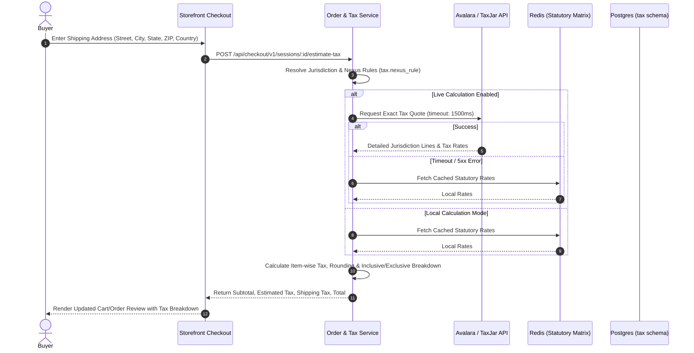

# 33 — Tax & VAT Engine: Cross-Border Rules, Nexus & Calculation

Status: DRAFT  
Related: `07-data-model.md`, `12-cart-checkout-orders.md`, `13-payments-and-payouts.md`, `24-i18n-localization.md`, `25-database-conventions.md`

---

## 1. Problem & Scope

Operating a global multi-vendor marketplace requires handling jurisdictional tax compliance across diverse legal frameworks:
1. **Value-Added Tax (VAT / GST)**: Predominant in Europe, UK, Australia, and many Asian countries. Requires VAT-inclusive pricing on consumer storefronts (`tax_inclusive = true`), seller VAT registration validation, reverse-charge mechanisms for cross-border B2B transactions, and marketplace facilitator liabilities (e.g. EU OSS / IOSS).
2. **US State & Local Sales Tax**: Destination-based economic nexus rules (Wayfair decision). Tax is calculated dynamically at checkout based on the buyer's exact 9-digit ZIP code shipping destination, product taxability category (e.g. digital goods vs. apparel vs. groceries), and seller/marketplace nexus presence (`tax_inclusive = false`).
3. **Marketplace Facilitator Laws**: In most major jurisdictions, the platform (Shopnetic) is legally classified as the marketplace facilitator, responsible for calculating, collecting, and remitting sales tax/VAT on behalf of third-party sellers.

This document defines the data model, integration architecture with third-party calculation engines (Avalara AvaTax / TaxJar), local fallback calculation engines, and checkout state transitions.

---

## 2. Core Architectural Invariants

1. **Marketplace Facilitator Remittance**:
   - Unless a third-party seller has verified enterprise tax autonomy (`seller.tax_remittance = 'seller'`), Shopnetic acts as the facilitator (`seller.tax_remittance = 'marketplace'`).
   - For facilitator orders, tax collected from the buyer is credited to the platform tax liability ledger (`tax.liability` — lives under this doc's own `tax` schema, not `identity`, since it's a financial ledger, not an accounts/RBAC concern), not disbursed in the seller's payout balance.
2. **Display Rule Determinism (Inclusive vs. Exclusive)**:
   - Determined by the active **storefront market / buyer shipping territory**, not the seller's origin:
     - EU / UK / AU / NZ: **Tax-Inclusive** display (`tax_inclusive: true`). Product listings, cart items, and catalog prices display gross prices including standard VAT. Invoices display net + VAT breakdown.
     - US / CA: **Tax-Exclusive** display (`tax_inclusive: false`). Product listings display net base price; estimated tax is calculated upon entry of shipping destination at checkout.
3. **Immutable Tax Line Snapshot**:
   - Every `order_line` captures: `tax_category_code`, `tax_rate`, `tax_amount_minor`, `tax_inclusive`, `jurisdiction_code`, and `engine_transaction_id` (Avalara/TaxJar doc code). Post-order tax rate changes never affect placed orders.
4. **Resilient Dual-Tier Calculation Architecture**:
   - Primary: Live SaaS API integration (Avalara AvaTax / Stripe Tax / TaxJar).
   - Fallback: Local database-backed statutory rate matrix (`tax.rate` + `tax.nexus_rule`) cached in Redis (`TTL: 24h`) if upstream tax API exceeds 1500ms timeout or returns 5xx.

---

## 3. Data Model (`tax` Schema)

```sql
CREATE SCHEMA IF NOT EXISTS tax;

-- Product taxability categories (e.g., standard, apparel, digital_goods, exempt)
CREATE TABLE tax.tax_category (
  id                  UUID PRIMARY KEY DEFAULT gen_random_uuid(),
  code                VARCHAR(64) UNIQUE NOT NULL, -- e.g., 'PC040100' (Avalara apparel)
  name                VARCHAR(128) NOT NULL,
  description         TEXT,
  is_active           BOOLEAN NOT NULL DEFAULT true,
  created_at          TIMESTAMPTZ NOT NULL DEFAULT NOW(),
  updated_at          TIMESTAMPTZ NOT NULL DEFAULT NOW()
);

-- Territorial nexus rules governing where the platform/seller collects tax
CREATE TABLE tax.nexus_rule (
  id                  UUID PRIMARY KEY DEFAULT gen_random_uuid(),
  country_code        VARCHAR(2) NOT NULL,        -- ISO 3166-1 alpha-2
  subdivision_code    VARCHAR(8),                 -- State/Province (e.g., 'CA', 'NY', 'ON')
  tax_inclusive       BOOLEAN NOT NULL DEFAULT false,
  is_facilitator      BOOLEAN NOT NULL DEFAULT true,
  threshold_amount    BIGINT,                     -- Economic nexus GMV threshold (minor units)
  threshold_orders    INTEGER,                    -- Economic nexus transaction count threshold
  is_active           BOOLEAN NOT NULL DEFAULT true,
  created_at          TIMESTAMPTZ NOT NULL DEFAULT NOW(),
  updated_at          TIMESTAMPTZ NOT NULL DEFAULT NOW(),
  CONSTRAINT uq_tax_nexus UNIQUE (country_code, subdivision_code)
);

-- Statutory fallback tax rates (used when live tax SaaS is offline/timed out)
CREATE TABLE tax.statutory_rate (
  id                  UUID PRIMARY KEY DEFAULT gen_random_uuid(),
  country_code        VARCHAR(2) NOT NULL,
  subdivision_code    VARCHAR(8),
  postal_code_pattern VARCHAR(32),                -- Optional regex/prefix pattern
  tax_category_id     UUID REFERENCES tax.tax_category(id) ON DELETE RESTRICT,
  rate_percentage     NUMERIC(7, 4) NOT NULL,     -- e.g., 20.0000 for 20% VAT, 8.8750 for NY NYC
  tax_name            VARCHAR(64) NOT NULL,       -- 'VAT', 'GST', 'State Sales Tax'
  effective_from      TIMESTAMPTZ NOT NULL,
  effective_to        TIMESTAMPTZ,
  created_at          TIMESTAMPTZ NOT NULL DEFAULT NOW(),
  updated_at          TIMESTAMPTZ NOT NULL DEFAULT NOW()
);

-- Seller tax profiles & exemptions
CREATE TABLE tax.seller_tax_profile (
  seller_id           UUID PRIMARY KEY,           -- References seller.seller(id)
  vat_number          VARCHAR(64),                -- Verified via VIES / HMRC API
  vat_verified_at     TIMESTAMPTZ,
  us_ein              VARCHAR(32),
  tax_remittance      VARCHAR(32) NOT NULL DEFAULT 'marketplace', -- 'marketplace' | 'seller'
  created_at          TIMESTAMPTZ NOT NULL DEFAULT NOW(),
  updated_at          TIMESTAMPTZ NOT NULL DEFAULT NOW()
);

-- Platform facilitator tax liability ledger (collected-but-not-yet-remitted tax)
CREATE TABLE tax.liability (
  id                  UUID PRIMARY KEY DEFAULT gen_random_uuid(),
  order_id            UUID NOT NULL,
  jurisdiction_code    VARCHAR(16) NOT NULL,       -- e.g. 'US-CA', 'GB'
  tax_amount_minor    BIGINT NOT NULL,
  currency            VARCHAR(3) NOT NULL,
  remitted            BOOLEAN NOT NULL DEFAULT false,
  remitted_at         TIMESTAMPTZ,
  created_at          TIMESTAMPTZ NOT NULL DEFAULT NOW()
);
```

---

## 4. Tax Calculation Flow (Checkout Integration)



---

## 5. UI Tests Specification (Tax & VAT Configuration)

### Comprehensive Tax & VAT Test Suite (Sorted & Grouped)

All Back Office Tax Management tests are organized into functional feature groups in logical administrative order.

```
Group 1: Tax Nexus & Jurisdiction Rules Management
Group 2: Product Tax Category Mapping
Group 3: Checkout Tax Calculation & Inclusive/Exclusive Display
Group 4: Fallback Engine & Resiliency Tests
```

#### Group 1: Tax Nexus & Jurisdiction Rules Management

| # | Test Scenario | Target Feature / Modal | Steps & User Interactions | Expected & Verified Outcome | Verification Artifact |
|---|---|---|---|---|---|
| **1.1** | List Active Tax Nexus Rules | `TaxRulesTable` (`/settings/tax/nexus`) | Navigate to Tax Settings in Back Office. | Displays table of registered countries, states, economic nexus status, and inclusive/exclusive flags. | `tmp/tax/01-nexus-rules-table.png` |
| **1.2** | Add Economic Nexus Rule | `NexusRuleModal` | Click "+ Add Nexus Rule"; select Country "United States", State "California", threshold $500,000; save. | Validates state code uniqueness; persists rule; updates active nexus list. | `tmp/tax/02-nexus-rule-created.png` |
| **1.3** | Toggle Tax-Inclusive Market | `NexusRuleModal` | Edit United Kingdom nexus; set `tax_inclusive = true`. | Saves rule; subsequent UK storefront PDP requests render tax-inclusive retail pricing. | `tmp/tax/03-tax-inclusive-toggle.png` |

#### Group 2: Product Tax Category Mapping

| # | Test Scenario | Target Feature / Modal | Steps & User Interactions | Expected & Verified Outcome | Verification Artifact |
|---|---|---|---|---|---|
| **2.1** | Assign Tax Category to Category Node | `CategoryTaxModal` | Open Category edit; assign Tax Category "Apparel (PC040100)". | Category inherits tax category; child products automatically default to this tax code during checkout tax computation. | `tmp/tax/04-category-tax-mapping.png` |
| **2.2** | Product-Level Tax Code Override | `ProductFormModal` | In Advanced Settings, override category default with "Digital Download (D0000000)". | Overrides tax code on checkout quote; Avalara/TaxJar quotes exempt from physical shipping sales tax. | `tmp/tax/05-product-tax-override.png` |

#### Group 3: Checkout Tax Calculation & Inclusive/Exclusive Display

| # | Test Scenario | Target Feature / Modal | Steps & User Interactions | Expected & Verified Outcome | Verification Artifact |
|---|---|---|---|---|---|
| **3.1** | US Destination Checkout (Exclusive) | Storefront Checkout | Enter shipping address in Los Angeles, CA (90001). | Displays separate "Estimated Tax" line item calculated at California state + LA county composite rate; subtotal excludes tax. | `tmp/tax/06-checkout-exclusive-tax.png` |
| **3.2** | UK Destination Checkout (Inclusive) | Storefront Checkout | Enter shipping address in London, UK. | Cart displays 20% VAT included in prices; checkout breakdown renders: "Includes £X.XX (20%) VAT". | `tmp/tax/07-checkout-inclusive-vat.png` |

#### Group 4: Fallback Engine & Resiliency Tests

| # | Test Scenario | Target Feature / Modal | Steps & User Interactions | Expected & Verified Outcome | Verification Artifact |
|---|---|---|---|---|---|
| **4.1** | SaaS Timeout Fallback to Statutory Matrix | Tax Service | Inject 2000ms delay or 500 fault on Avalara API endpoint. | System cleanly catches timeout; falls back to cached `tax.statutory_rate` table; checkout completes without user error or transaction abort. | `tmp/tax/08-tax-fallback-resilience.png` |

---

## 6. Master Architectural Blueprint & Future Commerce Differentiators Gap Analysis & Flagged Implementations

The following specifications from `plan/gemini/GEMINI_FUTURE_COMMERCE_DIFFERENTIATORS_2026_10_28.md` and `plan/38-future-commerce-differentiators.md` represent gaps in the current implementation of the Tax and Cross-Border Customs Engine:

1. **[FLAGGED - Missing Implementation] DDP Landed Cost Calculator, Cross-Border Harmonized System (HS) Codes & Customs Insurance (Plan 38, Section 3.2)**:
   - *Current State*: Sales tax and VAT engine computes domestic and regional consumption taxes based on destination ZIP/country and tax categories.
   - *Specification*: Cross-border landed cost calculation computing international freight, customs tariffs via 6-to-10 digit HS codes, import VAT/GST, and clearance brokerage fees upfront. Includes optional "Customs Clearance Guarantee" policy where the platform absorbs duty revisions or clearance demurrage variances.

