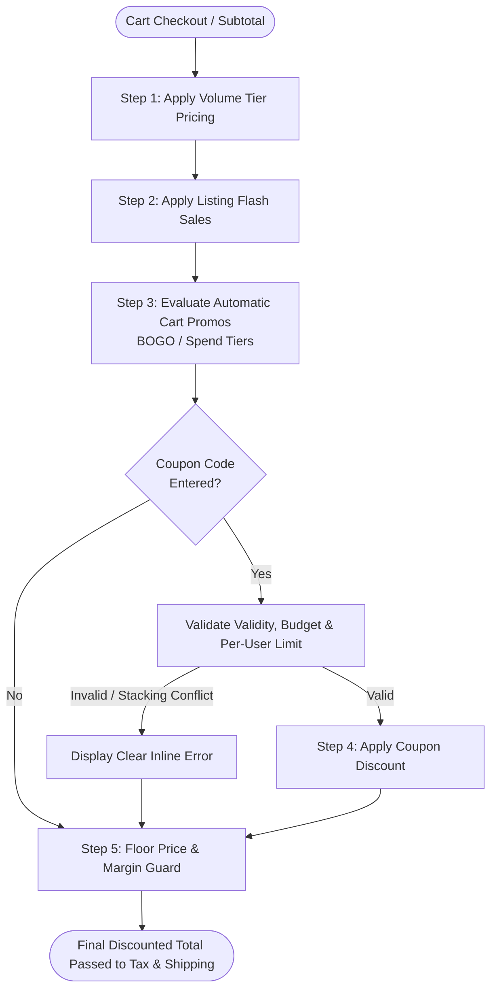

# 34 — Discount & Promotion Engine: Multi-Channel Rules, Stackability & Gamification

Status: DRAFT  
Related: `07-data-model.md`, `12-cart-checkout-orders.md`, `13-payments-and-payouts.md`, `26-catalog-options-variants-brands.md`, `29-cart-and-listing-change-alerts.md`

---

## 1. Problem & Scope

A high-conversion multi-vendor marketplace requires a versatile discount and loyalty engine supporting:
1. **Multi-Channel Ownership**: Platform-wide promotional campaigns (funded by Shopnetic), seller-specific store coupons (funded by individual merchants), and shared co-funded promotions.
2. **Diverse Promotional Mechanics**:
   - Percentage & Flat Amount Off (order-level, category-level, SKU-level).
   - Buy X, Get Y Free / Discounted (BOGO).
   - Tiered Spend Thresholds (e.g. *"Spend $100 save $15, spend $200 save $40"*).
   - Conditional Free Shipping (e.g. *"Free Standard Shipping on orders over $50"*).
   - Volume-Tiered / B2B Wholesale Pricing (e.g. 1–5 units @ $20, 6–20 units @ $16).
3. **Strict Stackability & Conflict Resolution**: Clear evaluation hierarchies preventing coupon stacking exploits that drive gross margins below zero.
4. **Gamification & Engagement Mechanics**: Daily check-in streaks, interactive quizzes yielding custom bundles, and spin-the-wheel reward vouchers.

---

## 2. Core Architectural Invariants

1. **Deterministic Evaluation Order (Precedence Waterfall)**:
   Discounts are evaluated strictly in the following sequential order:
   ```
   1. Volume / Tiered Pricing (SKU-level base price adjustment)
   2. Flash Sale / Catalog Markdown (Listing-level promo price)
   3. Automatic Order / Cart Promotions (e.g. BOGO, Spend-Thresholds)
   4. Coupon Code Redemption (Manual alphanumeric voucher code)
   5. Loyalty Points / Store Credit (Payment-stage deduction)
   ```
2. **Stackability Guardrails**:
   - By default, coupon codes are **non-stackable** with other coupon codes (`allow_coupon_stacking = false`). Maximum 1 coupon code allowed per checkout session.
   - Catalog-level promotions (Flash Sales) and coupon codes can combine **only if** `promotion.allow_with_sale_items = true`.
   - **Floor Price Protection**: An order item's effective price after all discounts can never fall below the seller's minimum floor price (`variant.floor_price_minor`) or a hard platform threshold (e.g. minimum 20% of MSRP), unless explicitly overridden by an Admin co-funded campaign.
3. **Atomic Redemption Claim & TTL Lock**:
   - When a buyer enters checkout, the applied coupon is soft-locked with a 15-minute TTL (`promotion.claim`).
   - Upon successful payment authorization, the redemption is committed permanently (`promotion.redemption`). If the checkout session expires or aborts, the reservation releases automatically back to the pool.
4. **Budget & Limit Caps**:
   - Campaigns automatically terminate when `current_spend_minor >= total_budget_minor` or `redemption_count >= max_redemptions`.
   - Per-user redemption limits (`max_per_user`) are strictly enforced via PostgreSQL unique constraints against `(promotion_id, account_id)`.

---

## 3. Data Model (`promotion` Schema)

```sql
CREATE SCHEMA IF NOT EXISTS promotion;

-- Core promotion & campaign definition
CREATE TABLE promotion.campaign (
  id                          UUID PRIMARY KEY DEFAULT gen_random_uuid(),
  code                        VARCHAR(64) UNIQUE,                 -- Null for automatic promotions
  name                        VARCHAR(128) NOT NULL,
  description                 TEXT,
  scope_type                  VARCHAR(32) NOT NULL,               -- 'platform' | 'seller'
  seller_id                   UUID,                               -- Scoped to seller if scope_type = 'seller'
  funding_split_platform_pct  INTEGER NOT NULL DEFAULT 0,         -- % funded by platform (0-100)
  funding_split_seller_pct    INTEGER NOT NULL DEFAULT 100,       -- % funded by seller (0-100)
  discount_type               VARCHAR(32) NOT NULL,               -- 'percentage' | 'fixed_amount' | 'bogo' | 'free_shipping' | 'tiered'
  discount_value_minor        BIGINT,                             -- Minor units for fixed, basis points for % (e.g. 1500 = 15.00%)
  min_spend_minor             BIGINT NOT NULL DEFAULT 0,
  max_discount_cap_minor      BIGINT,                             -- Ceiling for percentage discounts
  allow_with_sale_items       BOOLEAN NOT NULL DEFAULT false,
  is_automatic                BOOLEAN NOT NULL DEFAULT false,     -- Auto-applied without code
  max_total_redemptions       INTEGER,
  max_per_user                INTEGER NOT NULL DEFAULT 1,
  total_budget_minor          BIGINT,                             -- Total financial liability cap
  current_spend_minor         BIGINT NOT NULL DEFAULT 0,
  redemption_count            INTEGER NOT NULL DEFAULT 0,
  starts_at                   TIMESTAMPTZ NOT NULL,
  ends_at                     TIMESTAMPTZ NOT NULL,
  is_active                   BOOLEAN NOT NULL DEFAULT true,
  created_at                  TIMESTAMPTZ NOT NULL DEFAULT NOW(),
  updated_at                  TIMESTAMPTZ NOT NULL DEFAULT NOW()
);

-- Target eligibility rules (which categories, products, or user tiers qualify)
CREATE TABLE promotion.campaign_target (
  id                          UUID PRIMARY KEY DEFAULT gen_random_uuid(),
  campaign_id                 UUID NOT NULL REFERENCES promotion.campaign(id) ON DELETE CASCADE,
  target_type                 VARCHAR(32) NOT NULL,               -- 'category' | 'product' | 'brand' | 'user_segment'
  target_id                   UUID NOT NULL,                      -- Foreign ID of target entity
  is_inclusion                BOOLEAN NOT NULL DEFAULT true,      -- true = eligible; false = excluded
  created_at                  TIMESTAMPTZ NOT NULL DEFAULT NOW()
);

-- Tiered spend rules (e.g. spend $100 save $15, spend $200 save $40)
CREATE TABLE promotion.tiered_rule (
  id                          UUID PRIMARY KEY DEFAULT gen_random_uuid(),
  campaign_id                 UUID NOT NULL REFERENCES promotion.campaign(id) ON DELETE CASCADE,
  threshold_spend_minor       BIGINT NOT NULL,
  discount_amount_minor       BIGINT NOT NULL,
  created_at                  TIMESTAMPTZ NOT NULL DEFAULT NOW()
);

-- Atomic redemption log per buyer account
CREATE TABLE promotion.redemption (
  id                          UUID PRIMARY KEY DEFAULT gen_random_uuid(),
  campaign_id                 UUID NOT NULL REFERENCES promotion.campaign(id) ON DELETE RESTRICT,
  account_id                  UUID NOT NULL,                      -- Buyer account
  order_id                    UUID NOT NULL,                      -- Placed order
  discount_applied_minor      BIGINT NOT NULL,
  redeemed_at                 TIMESTAMPTZ NOT NULL DEFAULT NOW(),
  CONSTRAINT uq_user_order_promo UNIQUE (campaign_id, order_id)
);

-- Gamification loyalty points & daily check-in streaks
CREATE TABLE promotion.loyalty_profile (
  account_id                  UUID PRIMARY KEY,
  points_balance              INTEGER NOT NULL DEFAULT 0,
  lifetime_points             INTEGER NOT NULL DEFAULT 0,
  current_streak_days         INTEGER NOT NULL DEFAULT 0,
  last_check_in_date          DATE,
  updated_at                  TIMESTAMPTZ NOT NULL DEFAULT NOW()
);
```

---

## 4. Promotion Evaluation Sequence



---

## 5. UI Tests Specification (Discounts & Promotions)

### Comprehensive Promotion & Loyalty Test Suite (Sorted & Grouped)

```
Group 1: Back Office Platform Campaign Management
Group 2: Seller Portal Store Coupon Management
Group 3: Buyer Cart & Checkout Coupon Application
Group 4: Gamification, Streaks & Mini-Game Rewards
Group 5: Resiliency, Stacking Violations & Concurrency Tests
```

#### Group 1: Back Office Platform Campaign Management

| # | Test Scenario | Target Feature / Modal | Steps & User Interactions | Expected & Verified Outcome | Verification Artifact |
|---|---|---|---|---|---|
| **1.1** | Create Platform-Wide Tiered Campaign | `CampaignFormModal` (`/marketing/campaigns`) | Click "+ New Campaign"; set Spend $100 save $15, Spend $200 save $40; set budget $10,000; save. | Validates date ranges and positive thresholds; persists campaign; displays active badge in directory. | `tmp/promotions/01-platform-tiered-campaign.png` |
| **1.2** | Exclude Specific Category from Promo | `CampaignTargetTab` | Edit campaign; add exclusion rule for "Electronics" category. | Excluded category badge appears; cart items from Electronics do not count toward spend thresholds. | `tmp/promotions/02-campaign-category-exclusion.png` |

#### Group 2: Seller Portal Store Coupon Management

| # | Test Scenario | Target Feature / Modal | Steps & User Interactions | Expected & Verified Outcome | Verification Artifact |
|---|---|---|---|---|---|
| **2.1** | Seller Creates Percentage Store Coupon | `SellerCouponModal` (`/promotions`) | Seller inputs code `SPRING20`, 20% off, min spend $50, max per user 1, funded 100% by seller. | Validates code uniqueness; persists coupon restricted strictly to the seller's storefront products. | `tmp/promotions/03-seller-coupon-created.png` |

#### Group 3: Buyer Cart & Checkout Coupon Application

| # | Test Scenario | Target Feature / Modal | Steps & User Interactions | Expected & Verified Outcome | Verification Artifact |
|---|---|---|---|---|---|
| **3.1** | Apply Valid Coupon Code | Storefront Cart / Checkout | Enter coupon `SPRING20` in promo code input; click "Apply". | Discount is verified and applied; order summary updates with green badge showing "-$20.00"; subtotal recalculates. | `tmp/promotions/04-checkout-coupon-applied.png` |
| **3.2** | Expired or Budget-Exhausted Coupon | Storefront Cart / Checkout | Enter expired code `WINTER10`. | Input shakes; localized error alert displays: *"This coupon has expired or reached its maximum redemption limit."* | `tmp/promotions/05-coupon-expired-error.png` |

#### Group 4: Gamification, Streaks & Mini-Game Rewards

| # | Test Scenario | Target Feature / Modal | Steps & User Interactions | Expected & Verified Outcome | Verification Artifact |
|---|---|---|---|---|---|
| **4.1** | Daily Check-in Streak Reward | Buyer Account Hub | Click "Daily Check-In" button. | Increments `current_streak_days` by 1; awards +50 points; animates check-in calendar; generates voucher on 7-day milestone. | `tmp/promotions/06-daily-checkin-streak.png` |

#### Group 5: Resiliency, Stacking Violations & Concurrency Tests

| # | Test Scenario | Target Feature / Modal | Steps & User Interactions | Expected & Verified Outcome | Verification Artifact |
|---|---|---|---|---|---|
| **5.1** | Non-Stackable Coupon Rejection | Storefront Cart | Apply second coupon `EXTRA10` while `SPRING20` is already applied. | System blocks second entry with message: *"Only one coupon code may be applied per order."* | `tmp/promotions/07-stacking-rejected.png` |
| **5.2** | Concurrent Last-Redemption Race Condition | Two parallel checkouts | Two buyers attempt final redemption on a coupon with 1 remaining slot. | First checkout commits; second checkout cleanly catches slot exhaustion, rollbacks discount, and prompts user to proceed at regular price. | `tmp/promotions/08-redemption-race-resilience.png` |

---

## 6. Master Architectural Blueprint & Future Commerce Differentiators Gap Analysis & Flagged Implementations

The following specifications from `plan/gemini/GEMINI_FUTURE_COMMERCE_DIFFERENTIATORS_2026_10_28.md` and `plan/38-future-commerce-differentiators.md` represent gaps in the current implementation of Promotions and Pricing Mechanics:

1. **[FLAGGED - Missing Implementation] Automated Price Drop Protection Engine (Plan 38, Section 3.6)**:
   - *Current State*: Promotions apply at the time of catalog browsing or checkout session creation.
   - *Specification*: Post-purchase price monitoring engine tracking delivered eligible orders for 7 to 14 days. If the purchased item drops in price on the platform, an automated claim (`pricing.price_protection_claim`) issues a difference refund to the buyer's store credit wallet and sends instant notification.

2. **[FLAGGED - Missing Implementation] Community Group Buy Tiered Bulk Discounts (Plan 38, Section 3.3)**:
   - *Current State*: Volume tiers are fixed to single-buyer order line quantities.
   - *Specification*: Multi-buyer pooled order campaigns scoped to geographic geofences (neighborhood pickup points). When pooled order quantities cross dynamic thresholds (e.g., 5 orders = 10% off, 20 orders = 25% off + free group shipping), wholesale tiered discounts unlock for all participating neighbors.

