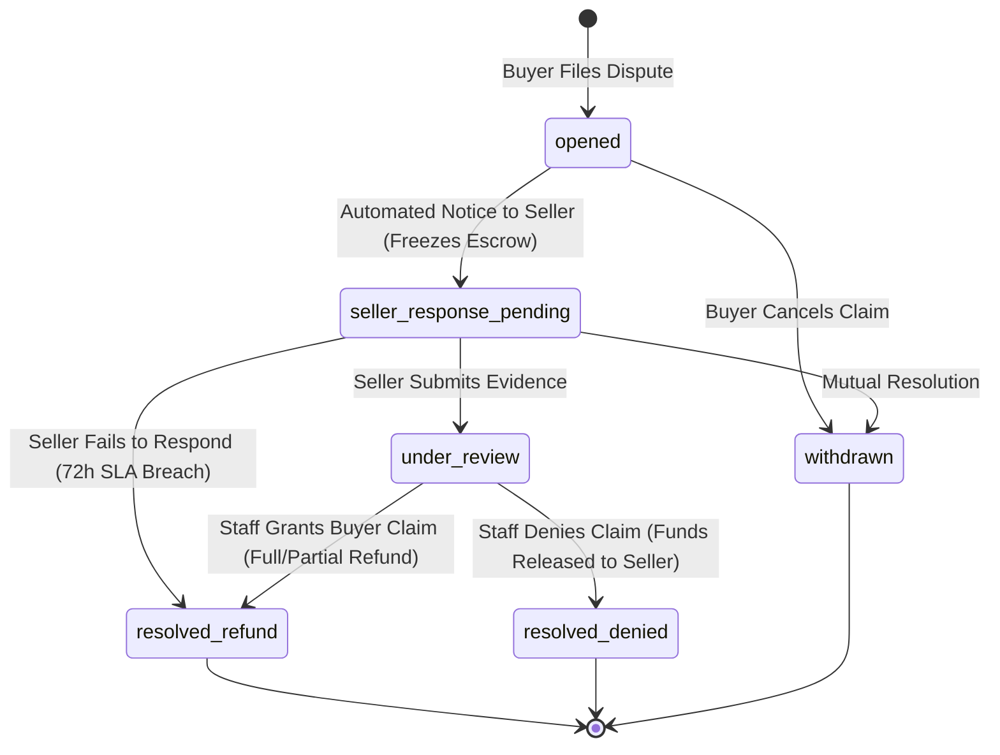

# 35 — Reviews, Ratings, Community Q&A & Dispute Resolution

Status: DRAFT  
Related: `04-features-buyer.md`, `05-features-seller.md`, `06-features-admin.md`, `07-data-model.md`, `12-cart-checkout-orders.md`, `13-payments-and-payouts.md`

---

## 1. Problem & Scope

Buyer trust and catalog integrity depend on authentic feedback and structured dispute resolution:
1. **Verified Buyer Reviews & Ratings**: Rich reviews with 1–5 star ratings, headline, detailed body, photo/video media attachments, verified-purchase badges, and helpfulness voting (`helpful_count`).
2. **Community Q&A**: Prospective buyers asking questions about products, answered by verified owners, sellers, or staff moderators.
3. **Fraud & Misinformation Reporting Center**: Buyer reporting channel to flag counterfeit listings, misleading specifications, policy violations, or suspicious merchant behavior directly to Service Admins.
4. **A-to-Z Dispute & Claim Management**: Formal mediation console for order issues (item not received, damaged in transit, materially different from listing) with evidence collection, messaging timeline, escrow hold freeze, and staff adjudication.

---

## 2. Core Architectural Invariants

1. **Verified Purchase Distinction**:
   - Any registered buyer can post a review, but reviews are strictly tagged with `is_verified_purchase = true` **if and only if** the buyer's account possesses an order line for that product in `delivered` or `completed` status (`order.status IN ('delivered', 'completed')`).
   - One review per product per buyer account (subsequent edits update the existing review, tracking `edited_at`).
2. **Review Aggregation & Denormalization**:
   - `Product.rating_average` (numeric 3,2) and `Product.rating_count` (integer) are asynchronously updated via outbox events (`catalog.review_published`) or transactional triggers.
   - Verified reviews carry higher statistical weight in search ranking and Buy Box calculations (`27-merchandising-and-ranking.md`).
3. **Automated Toxicity & Moderation Filter**:
   - Reviews and Q&A entries pass through automated content screening (profanity, external URLs, contact details, toxicity).
   - Flagged reviews enter the Service Admin moderation queue (`status = 'under_review'`); clean reviews publish immediately (`status = 'published'`).
4. **Dispute Escrow Freezing**:
   - Opening an A-to-Z dispute (`dispute.case`) immediately freezes the seller's payout balance for that sub-order, placing the funds into `escrow_disputed` status until case resolution.
   - A dispute case enforces an automated seller response SLA (e.g. 72 hours). Failure to respond results in an automated default judgment in favor of the buyer with full refund.

---

## 3. Data Model (`review` Schema)

```sql
CREATE SCHEMA IF NOT EXISTS review;

-- Product reviews & star ratings
CREATE TABLE review.product_review (
  id                      UUID PRIMARY KEY DEFAULT gen_random_uuid(),
  product_id              UUID NOT NULL,                      -- References catalog.product(id)
  variant_id              UUID,                               -- Optional variant purchased
  account_id              UUID NOT NULL,                      -- Author
  order_line_id           UUID,                               -- Proves verified purchase
  is_verified_purchase    BOOLEAN NOT NULL DEFAULT false,
  rating                  SMALLINT NOT NULL CHECK (rating BETWEEN 1 AND 5),
  title                   VARCHAR(128) NOT NULL,
  body                    TEXT NOT NULL,
  helpful_count           INTEGER NOT NULL DEFAULT 0,
  unhelpful_count         INTEGER NOT NULL DEFAULT 0,
  status                  VARCHAR(32) NOT NULL DEFAULT 'published', -- 'published' | 'under_review' | 'hidden' | 'deleted'
  seller_response         TEXT,
  seller_responded_at     TIMESTAMPTZ,
  created_at              TIMESTAMPTZ NOT NULL DEFAULT NOW(),
  updated_at              TIMESTAMPTZ NOT NULL DEFAULT NOW(),
  CONSTRAINT uq_product_reviewer UNIQUE (product_id, account_id)
);

-- Media attached to reviews (customer photos & unboxing videos)
CREATE TABLE review.review_media (
  id                      UUID PRIMARY KEY DEFAULT gen_random_uuid(),
  review_id               UUID NOT NULL REFERENCES review.product_review(id) ON DELETE CASCADE,
  media_type              VARCHAR(16) NOT NULL,               -- 'image' | 'video'
  media_url               TEXT NOT NULL,
  thumbnail_url           TEXT,
  sort_order              INTEGER NOT NULL DEFAULT 0,
  created_at              TIMESTAMPTZ NOT NULL DEFAULT NOW()
);

-- Community Q&A questions
CREATE TABLE review.product_question (
  id                      UUID PRIMARY KEY DEFAULT gen_random_uuid(),
  product_id              UUID NOT NULL,
  account_id              UUID NOT NULL,
  question_text           TEXT NOT NULL,
  status                  VARCHAR(32) NOT NULL DEFAULT 'published',
  upvotes                 INTEGER NOT NULL DEFAULT 0,
  created_at              TIMESTAMPTZ NOT NULL DEFAULT NOW()
);

-- Community Q&A answers
CREATE TABLE review.product_answer (
  id                      UUID PRIMARY KEY DEFAULT gen_random_uuid(),
  question_id             UUID NOT NULL REFERENCES review.product_question(id) ON DELETE CASCADE,
  account_id              UUID NOT NULL,
  author_type             VARCHAR(32) NOT NULL,               -- 'buyer' | 'seller' | 'staff'
  answer_text             TEXT NOT NULL,
  is_accepted             BOOLEAN NOT NULL DEFAULT false,
  upvotes                 INTEGER NOT NULL DEFAULT 0,
  created_at              TIMESTAMPTZ NOT NULL DEFAULT NOW()
);

-- Buyer fraud, counterfeit & policy violation reports
CREATE TABLE review.misinformation_report (
  id                      UUID PRIMARY KEY DEFAULT gen_random_uuid(),
  reporter_account_id     UUID NOT NULL,
  target_type             VARCHAR(32) NOT NULL,               -- 'product' | 'seller' | 'review'
  target_id               UUID NOT NULL,
  reason_category         VARCHAR(64) NOT NULL,               -- 'counterfeit' | 'misleading_specs' | 'offensive' | 'scam'
  evidence_text           TEXT,
  evidence_urls           TEXT[],
  status                  VARCHAR(32) NOT NULL DEFAULT 'pending', -- 'pending' | 'investigating' | 'actioned' | 'dismissed'
  reviewer_account_id     UUID,
  resolution_note         TEXT,
  action_taken            VARCHAR(64),                        -- 'listing_suppressed' | 'seller_warned' | 'none'
  created_at              TIMESTAMPTZ NOT NULL DEFAULT NOW(),
  updated_at              TIMESTAMPTZ NOT NULL DEFAULT NOW()
);

-- Formal A-to-Z dispute resolution cases
CREATE TABLE review.dispute_case (
  id                      UUID PRIMARY KEY DEFAULT gen_random_uuid(),
  case_number             VARCHAR(32) UNIQUE NOT NULL,        -- e.g. 'DISP-2026-00812'
  order_id                UUID NOT NULL,
  sub_order_id            UUID NOT NULL,
  buyer_account_id        UUID NOT NULL,
  seller_id               UUID NOT NULL,
  claim_reason            VARCHAR(64) NOT NULL,               -- 'not_received' | 'damaged' | 'materially_different' | 'unauthorized'
  disputed_amount_minor   BIGINT NOT NULL,
  status                  VARCHAR(32) NOT NULL DEFAULT 'opened', -- 'opened' | 'seller_response_pending' | 'under_review' | 'resolved_refund' | 'resolved_denied' | 'withdrawn'
  seller_deadline_at      TIMESTAMPTZ NOT NULL,               -- 72h SLA
  adjudicator_account_id  UUID,                               -- Staff member who resolved
  resolution_summary      TEXT,
  refund_transaction_id   UUID,
  created_at              TIMESTAMPTZ NOT NULL DEFAULT NOW(),
  updated_at              TIMESTAMPTZ NOT NULL DEFAULT NOW()
);
```

---

## 4. A-to-Z Dispute State Machine



---

## 5. UI Tests Specification (Reviews & Disputes)

### Comprehensive Review, Q&A & Dispute Test Suite (Sorted & Grouped)

```
Group 1: Verified Buyer Review Submission & Media Upload
Group 2: Review Helpful Voting & Seller Public Response
Group 3: Community Q&A Interaction
Group 4: Fraud & Counterfeit Reporting Flow
Group 5: A-to-Z Dispute Case Management & Mediation Console
```

#### Group 1: Verified Buyer Review Submission & Media Upload

| # | Test Scenario | Target Feature / Modal | Steps & User Interactions | Expected & Verified Outcome | Verification Artifact |
|---|---|---|---|---|---|
| **1.1** | Submit Verified Review with Images | `ReviewFormModal` | On delivered order item, click "Write a Product Review"; select 5 stars; enter title/body; upload 2 photos; submit. | Review saves; displays prominent green "Verified Purchase" badge and image thumbnails on PDP review section. | `tmp/reviews/01-verified-review-with-photos.png` |
| **1.2** | Duplicate Review Blocked | `ReviewFormModal` | Attempt submitting second review on same product. | Button switches to "Edit your existing review"; form pre-fills previous submission; prevents duplicate row creation. | `tmp/reviews/02-edit-existing-review.png` |

#### Group 2: Review Helpful Voting & Seller Public Response

| # | Test Scenario | Target Feature / Modal | Steps & User Interactions | Expected & Verified Outcome | Verification Artifact |
|---|---|---|---|---|---|
| **2.1** | Upvote Helpful Review | Review Card on PDP | Click "Helpful" button on customer review. | Increments `helpful_count` (+1); button highlights; persists vote preventing repeat clicks by same account. | `tmp/reviews/03-helpful-vote-incremented.png` |
| **2.2** | Seller Public Response | Seller Portal Reviews | Merchant submits reply: *"Thank you for your feedback!"*. | Reply appears indented beneath review with official "Seller Response" badge on public PDP. | `tmp/reviews/04-seller-review-reply.png` |

#### Group 3: Community Q&A Interaction

| # | Test Scenario | Target Feature / Modal | Steps & User Interactions | Expected & Verified Outcome | Verification Artifact |
|---|---|---|---|---|---|
| **3.1** | Ask Question & Verified Owner Answer | PDP Q&A Section | Submit question: *"Is this dishwasher safe?"*; verified owner replies. | Question publishes; reply renders with "Verified Buyer" attribution tag. | `tmp/reviews/05-product-qa-thread.png` |

#### Group 4: Fraud & Counterfeit Reporting Flow

| # | Test Scenario | Target Feature / Modal | Steps & User Interactions | Expected & Verified Outcome | Verification Artifact |
|---|---|---|---|---|---|
| **4.1** | Report Counterfeit Listing | `ReportItemModal` | Click "Report this product"; select "Suspected Counterfeit"; provide photos/text; submit. | Report queued in Service Admin queue; confirmation alert displayed; product remains live pending investigation. | `tmp/reviews/06-fraud-report-submitted.png` |

#### Group 5: A-to-Z Dispute Case Management & Mediation Console

| # | Test Scenario | Target Feature / Modal | Steps & User Interactions | Expected & Verified Outcome | Verification Artifact |
|---|---|---|---|---|---|
| **5.1** | File Dispute & Verify Escrow Hold | Buyer Order Details | File dispute for "Item not received"; submit tracking inquiry. | Case `DISP-...` generated; sub-order escrow placed on hold; 72h countdown timer starts on seller portal. | `tmp/reviews/07-dispute-filed-escrow-hold.png` |
| **5.2** | Admin Adjudication & Refund | Back Office Dispute Console | Service Admin reviews evidence, clicks "Grant Claim & Refund Buyer". | Sub-order refund initiates via payment gateway; dispute transitions to `resolved_refund`; seller metrics penalized. | `tmp/reviews/08-dispute-adjudication-refund.png` |
