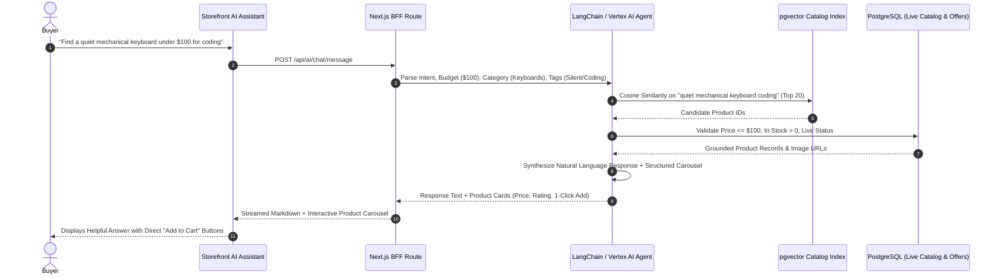

# 37 — Artificial Intelligence (AI) & Machine Learning Layer

Status: DRAFT  
Related: `04-features-buyer.md`, `05-features-seller.md`, `06-features-admin.md`, `07-data-model.md`, `11-search-and-catalog.md`, `26-catalog-options-variants-brands.md`, `27-merchandising-and-ranking.md`

---

## 1. Problem & Scope

The modern multi-vendor marketplace integrates artificial intelligence across buyer discovery, seller productivity, and administrative governance:
1. **Conversational Shopping Assistants**:
   - The "Personal Shopper" Chatbot: Natural language conversational search parsing complex multi-constraint requests (e.g., *"Looking for a waterproof hiking backpack under $120 with laptop compartment delivered before Thursday"*), assembling matching product bundles for instant cart addition.
   - Gift & Occasion Concierge: Interactive AI recommendations with auto-generated gift card messages.
2. **Multimodal Visual & Contextual Search**:
   - "Snap & Find" Visual Search: Camera or photo upload mapped to catalog vector embeddings (`pgvector` / specialized vector DB) matching colors, textures, and silhouettes.
   - "Shop the Look" Automated Hotspots: Deep learning models automatically tagging garments and accessories in lifestyle imagery with catalog buy links.
3. **Hyper-Personalization & Sizing Intelligence**:
   - Dynamic Layout Personalization: Real-time re-ranking of category grids, homepage banners, and recommendations based on user intent and click-stream signals.
   - AI Size & Fit Predictor: Recommending optimal garment/shoe sizes (`S`, `M`, `L`) based on brand sizing curves, customer measurements, and historical return data.
4. **Seller Automation & Catalog Intelligence**:
   - AI Product Description Generator: Transforming raw technical attributes and photos into SEO-optimized, engaging product descriptions and structured bullet points formatted in ProseMirror AST (`catalog-description.ts`).
   - Automated Background Removal & Image Enhancement: Cleans up seller product photos to neutral white backgrounds matching marketplace quality standards.
   - Automated Content Moderation: Pre-screening listing titles, descriptions, and seller notes for toxicity, counterfeit terminology, prohibited items, or contact info leakage.
5. **Predictive Operations & Smart Support**:
   - AI-First Customer Support Triage: Auto-resolving repetitive queries (*"Where is my order?"*, *"How do I return this?"*) with zero human wait time.
   - Demand Forecasting for Sellers: Predictive inventory replenishment recommendations based on seasonal sales velocity.
   - Dynamic Buy Box Pricing Recommendations: Advising sellers on optimal price points to capture the Buy Box.

---

## 2. Core Architectural Invariants

**[NOTE — see `22` R1]**: this layer (vector DB, RAG/LLM orchestration) adds
substantial new ops burden relative to the project's current lean Postgres/Redis/
BullMQ stack and its stated modular-monolith-first, avoid-premature-complexity
stance. Weigh against R1 before scheduling, not just against this doc's own phase.

1. **Deterministic Guardrails & Grounded Search**:
   - The conversational shopping assistant operates strictly on **grounded catalog retrieval** (Retrieval-Augmented Generation / RAG).
   - The LLM can never hallucinate product prices, inventory availability, or shipping timelines; all product cards rendered in chat must be backed by live database verification (`SELECT price, stock FROM inventory.offer ...`).
2. **Vector Embeddings & Hybrid Search**:
   - Products and visual search assets generate 768-dimensional multimodal embeddings stored in `catalog.product_embedding` via `pgvector` or Qdrant.
   - Search queries combine BM25 text keyword matching with dense vector cosine similarity (hybrid reciprocal rank fusion / RRF) for maximum semantic recall.
3. **Async Background Generation (Zero UI Blocking)**:
   - Heavy AI workloads (batch image background removal, bulk description generation, vector re-indexing) are processed asynchronously via BullMQ workers (`31-background-jobs-and-queues.md`).
4. **Auditability & Human-in-the-Loop Moderation**:
   - All AI automated moderation actions (flags, suppressions) write immutable records to `ai.moderation_log`. Sellers can appeal AI-triggered listing rejections to human Service Admins.

---

## 3. Data Model (`ai` Schema)

```sql
CREATE SCHEMA IF NOT EXISTS ai;

-- Conversational shopping assistant sessions
CREATE TABLE ai.chat_session (
  id                      UUID PRIMARY KEY DEFAULT gen_random_uuid(),
  account_id              UUID,                               -- Optional guest vs logged-in buyer
  locale                  VARCHAR(10) NOT NULL DEFAULT 'en',
  created_at              TIMESTAMPTZ NOT NULL DEFAULT NOW(),
  updated_at              TIMESTAMPTZ NOT NULL DEFAULT NOW()
);

-- Individual chat messages & retrieved product bundles
CREATE TABLE ai.chat_message (
  id                      UUID PRIMARY KEY DEFAULT gen_random_uuid(),
  session_id              UUID NOT NULL REFERENCES ai.chat_session(id) ON DELETE CASCADE,
  role                    VARCHAR(16) NOT NULL,               -- 'user' | 'assistant' | 'system'
  content                 TEXT NOT NULL,
  retrieved_product_ids   UUID[],                             -- Product IDs recommended in this turn
  created_at              TIMESTAMPTZ NOT NULL DEFAULT NOW()
);

-- Multimodal catalog vector embeddings (pgvector)
CREATE TABLE ai.product_embedding (
  product_id              UUID PRIMARY KEY,                   -- References catalog.product(id)
  embedding_vector        vector(768) NOT NULL,               -- Multimodal text+image embedding
  model_version           VARCHAR(32) NOT NULL,
  updated_at              TIMESTAMPTZ NOT NULL DEFAULT NOW()
);

-- Visual search query log
CREATE TABLE ai.visual_search_query (
  id                      UUID PRIMARY KEY DEFAULT gen_random_uuid(),
  account_id              UUID,
  source_image_url        TEXT NOT NULL,
  detected_categories     TEXT[],
  top_matched_product_ids UUID[],
  created_at              TIMESTAMPTZ NOT NULL DEFAULT NOW()
);

-- Automated content moderation logs
CREATE TABLE ai.moderation_log (
  id                      UUID PRIMARY KEY DEFAULT gen_random_uuid(),
  entity_type             VARCHAR(32) NOT NULL,               -- 'product' | 'review' | 'message'
  entity_id               UUID NOT NULL,
  flagged_reason          VARCHAR(64) NOT NULL,               -- 'prohibited_item' | 'counterfeit_term' | 'toxicity'
  confidence_score        NUMERIC(4, 3) NOT NULL,             -- 0.000 to 1.000
  action_taken            VARCHAR(32) NOT NULL,               -- 'auto_suppressed' | 'flagged_review' | 'allowed'
  created_at              TIMESTAMPTZ NOT NULL DEFAULT NOW()
);

-- Seller seasonal demand forecasts
CREATE TABLE ai.seller_demand_forecast (
  id                      UUID PRIMARY KEY DEFAULT gen_random_uuid(),
  seller_id               UUID NOT NULL,
  variant_id              UUID NOT NULL,
  forecast_week_start     DATE NOT NULL,
  predicted_units_demanded INTEGER NOT NULL,
  confidence_interval_low  INTEGER NOT NULL,
  confidence_interval_high INTEGER NOT NULL,
  recommended_restock_units INTEGER NOT NULL,
  created_at              TIMESTAMPTZ NOT NULL DEFAULT NOW()
);
```

---

## 4. RAG Conversational Shopping Architecture



---

## 5. UI Tests Specification (Artificial Intelligence Features)

### Comprehensive AI Test Suite (Sorted & Grouped)

```
Group 1: Personal Shopper Conversational Assistant
Group 2: "Snap & Find" Multimodal Visual Search
Group 3: AI Product Description Generator & Background Cleanup
Group 4: AI Size & Fit Recommendation Widget
Group 5: Automated Content Moderation & Demand Forecasting
```

#### Group 1: Personal Shopper Conversational Assistant

| # | Test Scenario | Target Feature / Modal | Steps & User Interactions | Expected & Verified Outcome | Verification Artifact |
|---|---|---|---|---|---|
| **1.1** | Conversational Product Search | `ChatDrawer` (Floating Widget) | Open AI Assistant; prompt: *"Show me wireless noise-canceling headphones under $150"*. | Assistant responds with grounded explanation; displays 3 matching live products in an interactive carousel with live prices and "Add to Bag" buttons. | `tmp/ai/01-conversational-shopping-assistant.png` |
| **1.2** | Out of Stock & Hallucination Guard | `ChatDrawer` | Prompt for an out-of-stock product. | System verifies real inventory; explains item is currently unavailable and recommends top in-stock alternatives without inventing false inventory. | `tmp/ai/02-hallucination-prevention.png` |

#### Group 2: "Snap & Find" Multimodal Visual Search

| # | Test Scenario | Target Feature / Modal | Steps & User Interactions | Expected & Verified Outcome | Verification Artifact |
|---|---|---|---|---|---|
| **2.1** | Upload Street Photo of Sneakers | Search Bar Visual Search Trigger | Click camera icon; upload photo of red high-top sneakers. | Detects category "Footwear / Sneakers"; computes embedding; returns catalog red high-top sneakers ranked by visual similarity. | `tmp/ai/03-visual-search-results.png` |

#### Group 3: AI Product Description Generator & Background Cleanup

| # | Test Scenario | Target Feature / Modal | Steps & User Interactions | Expected & Verified Outcome | Verification Artifact |
|---|---|---|---|---|---|
| **3.1** | Generate Description in Product Modal | `ProductFormModal` | In create modal, enter title "Noise-Canceling Wireless Earbuds" and category; click "Generate with AI". | Calls backend AI service; fills TipTap rich text editor with structured, marketing-ready ProseMirror AST (Features, Specifications, Care) conforming to schema. | `tmp/ai/04-ai-description-generator.png` |
| **3.2** | One-Click Background Removal | `MediaFormModal` | Upload photo with messy living room background; click "Remove Background". | Worker removes background; replaces with clean neutral white studio backdrop; saves WebP asset. | `tmp/ai/05-ai-background-removal.png` |

#### Group 4: AI Size & Fit Recommendation Widget

| # | Test Scenario | Target Feature / Modal | Steps & User Interactions | Expected & Verified Outcome | Verification Artifact |
|---|---|---|---|---|---|
| **4.1** | Size Recommendation on Apparel PDP | PDP Size Selector | Click "What's My Size?"; enter height 5'10", weight 165 lbs, regular fit preference. | Widget displays recommendation: *"Your recommended size is Medium (85% match based on fit data)"*; pre-selects Medium variant pill. | `tmp/ai/06-ai-size-fit-predictor.png` |

#### Group 5: Automated Content Moderation & Demand Forecasting

| # | Test Scenario | Target Feature / Modal | Steps & User Interactions | Expected & Verified Outcome | Verification Artifact |
|---|---|---|---|---|---|
| **5.1** | Counterfeit Prohibited Word Detection | Listing Submission | Seller creates product with title containing "Replica Luxury Handbag 1:1 AAA". | Automated moderation intercepts submission; blocks publishing with error: *"Prohibited terms detected. Counterfeits and unauthorized replicas are not allowed."*; logs incident in `ai.moderation_log`. | `tmp/ai/07-ai-moderation-intercept.png` |

---

## 6. Master Architectural Blueprint & Future Commerce Differentiators Gap Analysis & Flagged Implementations

The following specifications from `plan/gemini/GEMINI_FUTURE_COMMERCE_DIFFERENTIATORS_2026_10_28.md` and `plan/38-future-commerce-differentiators.md` represent gaps in the current implementation of Artificial Intelligence and Computer Vision:

1. **[FLAGGED - Missing Implementation] Instant AI-Verified Device Trade-In Diagnostics & Checkout Appraisal Engine (Plan 38, Section 3.4)**:
   - *Current State*: AI models handle text embeddings, visual search similarity, and content moderation.
   - *Specification*: Multimodal hardware diagnostic and condition grading model combining client-side sensor/screen test telemetry with high-resolution computer vision photo analysis. Evaluates screen scratch severity, casing dents, and OLED burn-in to assign deterministic condition grades and instant trade-in cash valuations applied directly to checkout cart balances.

