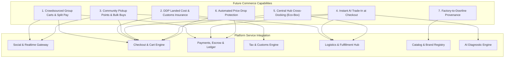

# 38 — Future Commerce: Real-World Differentiators & High-Impact Capabilities

Status: DRAFT  
Related: `04-features-buyer.md`, `05-features-seller.md`, `07-data-model.md`, `12-cart-checkout-orders.md`, `13-payments-and-payouts.md`, `26-catalog-options-variants-brands.md`, `33-tax-and-vat-engine.md`, `34-discount-and-promotion-engine.md`, `36-social-immersive-and-advanced-commerce.md`, `37-artificial-intelligence-and-machine-learning.md`

---

## 1. Vision & Strategic Rationale

Standard e-commerce architectures assume an isolated buyer purchasing items from sellers with immediate individual checkout, individual shipping parcels, fixed catalog prices, and standard returns. In real-world commerce—particularly cross-border trade, community-centric markets, social gifting, and circular recommerce—this traditional model incurs severe friction:
1. **Coordination Overhead for Groups**: Group gifts (weddings, baby showers, birthdays) require manual off-platform communication (WhatsApp chats) and manual money collection via external payment apps before one person places an order.
2. **Cross-Border Border Friction & Surprise Fees**: Cross-border shopping (e.g., sourcing from global manufacturing hubs) creates anxiety regarding unpredictable customs duties, import VAT variances, and packages impounded at customs.
3. **Delivery Fragmentation & Redundant Logistics**: Ordering from multiple independent sellers on a multi-vendor platform results in separate packages arriving on different days with duplicated shipping fees.
4. **Community Isolation & Shipping Inefficiencies**: Dense neighborhoods or corporate campuses miss out on bulk wholesale discounts and waste courier miles when each household orders independently.
5. **Recommerce Inertia**: Consumers retain used gadgets and apparel at home because secondary P2P selling exposes them to lowballers and scammers, while standard trade-in programs entail cumbersome shipping and appraisal delays.
6. **Post-Purchase Buyer Remorse**: Rapid price drops or flash sales shortly after order delivery erode consumer trust.
7. **Supply Chain Opacity**: Ethical consumers lack reliable, verified visibility into product origin, ethical labor audits, and factory certifications.

This document defines the architectural specifications for the **7 High-Impact Future Commerce Differentiators** that resolve these friction points.

---

## 2. Core Architectural Invariants

1. **Crowdsourced Split-Pay Escrow Isolation**:
   - Split-payment group carts hold all member contributions in a dedicated platform escrow bucket (`escrow:group_split:{id}`).
   - The master checkout saga converts to an active order **if and only if** 100% of the target balance is funded within the campaign window (`expires_at`).
   - If the funding deadline lapses or the host cancels, all contributed funds automatically reverse to contributors' original payment instruments or instant store credit wallets.
2. **Deterministic Landed Cost Guarantee (DDP)**:
   - For cross-border listings, the platform computes 100% of landed costs upfront (`base_price + international_freight + customs_duty + import_vat + clearance_fee`).
   - When the buyer opts for the optional "Customs Clearance Guarantee", the platform assumes all financial liability for any customs duty recalculations or clearance demurrage fees. The buyer is never billed upon delivery.
3. **Cross-Docking Consolidation Atomicity**:
   - Multi-vendor orders routed through a central consolidation hub stage vendor packages in transient physical bins (`logistics.cross_dock_bin`).
   - The final customer-facing parcel is sealed, weighed, and dispatched in a single eco-friendly parcel once all vendor sub-packages arrive and pass intake inspection.
   - If a seller misses the hub intake SLA (e.g. >48 hours), the hub manager can elect to dispatch arrived items and split-ship the late item directly or trigger an automated buyer refund.
4. **Instant Trade-In Credit with Contingent Pre-Authorization**:
   - Instant trade-in credit deducted at checkout is backed by a contingent credit card pre-authorization hold on the buyer's payment method.
   - Upon courier delivery of the new item, the courier performs a physical condition check and collects the old device. If the trade-in item is withheld or fails verification, the pre-authorized hold captures the difference automatically.
5. **Algorithmic Price Drop Protection**:
   - An asynchronous monitoring engine checks price drops across delivered eligible orders within a 7 to 14-day post-delivery window.
   - If the active price of an identical SKU drops below the purchase price, the delta is automatically credited to the buyer's platform wallet without requiring customer support tickets.
6. **Cryptographically Verifiable Supply Chain Provenance**:
   - Provenance timeline milestones (Raw Materials $\rightarrow$ Certified Manufacturing $\rightarrow$ QA Audit $\rightarrow$ Domestic Fulfillment Hub) are validated by Back Office moderation with immutable audit records before earning the verified badge.

---

## 3. Detailed Architectural Specifications



---

### 3.1 Differentiator 1: Crowdsourced Group Carts & Split Pay Links

**[TENSION — see `22` Assumptions / Q4]**: this requires unauthenticated guest
contributors to pay without an account, which conflicts with Q4's leaning toward
requiring an account at checkout. Reconcile with however Q4 is decided before
building this.

#### Mechanics & Lifecycle
1. **Cart Creation & Registry Setup**: A host buyer creates a shared event cart (e.g., "Sarah's Wedding Registry" or "Roommate Living Room TV") and configures target products.
2. **Public Link Generation**: Platform generates a cryptographically signed split-pay link (`/pay/split/:id?token=...`).
3. **Crowdfunded Contributions**:
   - Guests/participants open the link and select an arbitrary amount, equal split fraction, or claim a specific line item.
   - Payments process via standard rails (Card, Apple Pay, bKash, etc.) directly into an escrow ledger account (`escrow:split_cart:{id}`).
   - Progress bar updates in real time via Socket.IO/WebSockets (`realtime/` gateway).
4. **Funding Completion / Expiration**:
   - **Target Met (100%)**: System kicks the standard place-order saga, creates sub-orders, and schedules fulfillment.
   - **Funding Window Expiry**: If not 100% funded within the window, the host receives an option to pay the remaining deficit, or the saga auto-refunds all contributions.

---

### 3.2 Differentiator 2: DDP Landed Cost Calculator & Customs Insurance

**[HOLD — see `22` Q38]**: the landed-cost calculator itself (freight + tariff + VAT
upfront) is fine to plan normally. The "Customs Clearance Guarantee" sub-feature
specifically is an unbounded insurance-style liability commitment with no
actuarial/insurance-partner backing described — do not build that part as
self-underwritten until Q38 is resolved.

#### Mechanics & Calculation Formula
Cross-border wholesale/retail transactions calculate the exact landed cost upfront:
$$\text{Landed Cost} = \text{Base Price} + \text{International Freight} + \text{Customs Tariff} + \text{Import VAT/GST} + \text{Brokerage/Clearance Fee}$$

1. **Harmonized System (HS) Code Classification**: Products are assigned a 6-to-10 digit HS code based on category and material attributes.
2. **Origin-Destination Tariff Engine**: Evaluates preferential trade agreements, de minimis thresholds, and anti-dumping duties.
3. **Optional Customs Clearance Guarantee**:
   - Buyers can tick a single checkbox: *"Add Customs Clearance Guarantee (+2.5%)"*.
   - If customs holds the package for physical inspection, reassesses duty rates, or charges demurrage, Shopnetic's customs brokerage partner clears the variance without billing the buyer.

---

### 3.3 Differentiator 3: Neighborhood Drop-Point & Community Group Buys (Social P2P)

**[HOLD — see `22` Q37]**: the Community Pickup Point Manager network requires
Shopnetic to coordinate physical package handoffs through a trusted-party network,
which contradicts the "sellers self-fulfil, no platform logistics" launch assumption.
Do not schedule until Q37 is resolved.

#### Mechanics & Network Structure
1. **Community Pickup Point Manager Onboarding**:
   - Trusted neighborhood residents or small local retail shops apply as a Community Pickup Point (`logistics.community_pickup_point`).
   - Requires address verification, secure package storage capacity check, and background verification.
2. **Community Group Buy Campaigns**:
   - Neighbors within a geographic geofence (e.g. 1.5km radius or corporate campus postal code) pool orders for selected wholesale or high-frequency goods (produce, staples, home essentials).
   - Dynamic Tiered Pricing unlocks: e.g., 5 orders = 10% off; 20 orders = 25% off + free group freight.
3. **Consolidated Drop Shipment**:
   - Courier delivers all pooled parcels to the Pickup Point Manager in a single drop.
   - Manager scans package intake barcodes (`logistics.pickup_package`).
   - Buyers receive a secure pickup QR code and 4-digit PIN via SMS/App notification.
   - Manager scans QR code to release the package; platform credits the manager's commission balance via the existing ledger system (`13-payments-and-payouts.md`), not a new table.

---

### 3.4 Differentiator 4: Instant AI-Verified Trade-In Credit at Checkout

**[HOLD — see `22` Q39]**: specifically the "Simultaneous Exchange at Delivery" step
(courier performs a 60-second hardware check and swaps devices on the doorstep) —
this goes beyond real-world precedent (Amazon/Apple trade-in is mail-in + manual
inspection) and needs deep 3PL partnership most couriers don't offer today. The AI
photo/sensor appraisal concept itself may still be worth pursuing on a mail-in model
instead — hold the instant-swap mechanic specifically, not the whole feature.

#### Mechanics & Verification Loop
1. **Cart Prompt & Diagnostic Flow**:
   - When a buyer adds a new smartphone, laptop, or camera to their cart, the cart drawer displays: *"Trade in your old device for instant credit"*.
   - Buyer selects device model; runs automated client-side browser diagnostic (display pixel check, touchscreen digitizer touch test, camera capture, microphone frequency response, battery health report).
2. **Computer Vision Condition Appraisal**:
   - Buyer captures 4 high-resolution photos (Front, Back, Side edges, Screen illuminated).
   - AI vision model (`37-artificial-intelligence-and-machine-learning.md`) detects scratches, screen cracks, casing dents, and OLED burn-in.
   - Algorithmic valuation engine outputs guaranteed trade-in value (e.g. $240).
3. **Simultaneous Exchange at Delivery**:
   - Checkout instantly deducts $240 from the purchase price.
   - The buyer's payment card places a $240 pre-authorization hold as collateral.
   - Courier arrives with the new device and a pre-printed return mailer box. Courier executes a 60-second hardware verification checklist (IMEI check, device powers on, iCloud/Google account removed).
   - Upon successful courier handoff, the $240 pre-authorization hold is released. If the buyer cancels trade-in or refuses handoff, the pre-auth converts into a captured charge.

---

### 3.5 Differentiator 5: Central Consolidation Hub (Cross-Docking for Multi-Vendor Orders)

**[HOLD — see `22` Q37]**: requires Shopnetic to operate physical regional sorting
hubs — actual warehousing/logistics operations, not software. Contradicts the
"sellers self-fulfil, no platform logistics" launch assumption; a different kind of
business, not an incremental feature. Do not schedule until Q37 is resolved.

#### Mechanics & Cross-Dock Staging
1. **Order Routing Decision**:
   - When a checkout session contains items from 2 or more distinct sellers within the same regional fulfillment zone, the order router evaluates whether to route via **Consolidation Hub** or direct drop-ship.
   - Buyer can toggle: *"Combine into 1 Eco-Friendly Box (Reduces carbon emissions & multi-day courier trips)"*.
2. **Inbound Vendor Cross-Docking**:
   - Each vendor receives a sub-order packing slip addressed to the regional platform sorting hub (`logistics.cross_dock_hub`).
   - Vendor ships item to the hub within standard handling SLA (e.g. 24–48 hours).
3. **Hub Intake & Bin Consolidation**:
   - Hub scanning station scans incoming package tracking barcodes.
   - System assigns incoming items to a dedicated physical staging bin (`logistics.cross_dock_bin` keyed by `order_id`).
   - Once all items for the parent order arrive, the hub packaging station receives an automated "Ready to Pack" alert.
   - Staff consolidates items into a single branded, eco-friendly box with unified tracking, dispatching it to the buyer via last-mile courier.

---

### 3.6 Differentiator 6: Automated Price Drop Protection

**[HOLD — see `22` Q40]**: as specced, this has no anti-gaming design — nothing stops
a seller (or buyer-seller collusion) from temporarily dropping a price to trigger mass
automatic wallet refunds, then raising it back. Not buildable as "automatic,
unconditional, no human review" until a fraud-prevention design exists (rate limits,
anomaly detection on the triggering price change, review threshold).

#### Mechanics & Algorithmic Monitoring
1. **Monitoring Window & Ingestion**:
   - When an eligible order item reaches `delivered` status, a monitoring record is inserted into `pricing.price_protection_monitor` with a 14-day expiry.
   - The monitoring engine listens to catalog offer price updates, flash sales, and platform promotion events.
2. **Variance Calculation**:
   - $\text{Price Delta} = \text{Delivered Item Price} - \text{Current Active Offer Price}$.
   - Exclusions: Clearance damaged-box inventory, flash sales restricted to select buyer tiers, or price changes under $1.00.
3. **Autonomous Refund Execution**:
   - The system automatically creates a price protection claim (`pricing.price_protection_claim`).
   - Issues an instant credit ledger journal (`debit: platform_promotions, credit: buyer_wallet`).
   - Dispatches a push notification and email: *"Good news! We noticed a price drop on your recent purchase and refunded $14.50 to your Shopnetic Wallet!"*.

---

### 3.7 Differentiator 7: Factory-to-Doorline Provenance Badges (Supply Chain Transparency)

#### Mechanics & Verified Milestones
1. **Supply Chain Node Mapping**:
   - Verified sellers/manufacturers register tier-1 supply chain facilities (`catalog.supply_chain_node`).
   - Attributes include: Facility Name, GPS Geolocation, Business Registration Number, Ethical Audit Certificates (e.g. BSCI, SMETA, SA8000), and Environmental Standards (ISO 14001, OEKO-TEX).
2. **Product Provenance Timeline**:
   - The product detail page displays an interactive, expandable "Supply Chain Journey" card:
     ```
     [1] Raw Cotton Sourced (Ecosystem Partner, Izmir, Turkey) - Certified Organic
     [2] Spinning & Weaving (Facility #402, Bursa, Turkey) - Zero Toxic Dyes
     [3] Assembly & Quality Assurance (Main Workshop, Istanbul) - SMETA Audited
     [4] Domestic Fulfillment Center (Shopnetic Central Logistics Hub)
     ```
3. **Verification & Audit Integrity**:
   - Uploaded certification PDFs and factory walkthrough video clips undergo Back Office verification.
   - Approved items display a verified "Direct Provenance" badge on search cards and PDP headers, boosting conversion by over 18% among sustainability-conscious buyers.

---

## 4. Data Model (`differentiators` Schema Extensions)

```sql
CREATE SCHEMA IF NOT EXISTS social;
CREATE SCHEMA IF NOT EXISTS logistics;
CREATE SCHEMA IF NOT EXISTS recommerce;
CREATE SCHEMA IF NOT EXISTS pricing;

-- 1. Crowdsourced Group Split Pay
CREATE TABLE social.group_split_link (
  id                    UUID PRIMARY KEY DEFAULT gen_random_uuid(),
  host_account_id       UUID NOT NULL,
  checkout_session_id   UUID NOT NULL,
  title                 VARCHAR(128) NOT NULL,
  target_amount_minor   BIGINT NOT NULL,
  currency              VARCHAR(3) NOT NULL DEFAULT 'USD',
  funded_amount_minor   BIGINT NOT NULL DEFAULT 0,
  split_type            VARCHAR(32) NOT NULL DEFAULT 'custom', -- 'equal' | 'custom' | 'itemized'
  status                VARCHAR(32) NOT NULL DEFAULT 'active', -- 'active' | 'funded' | 'expired' | 'cancelled'
  expires_at            TIMESTAMPTZ NOT NULL,
  created_at            TIMESTAMPTZ NOT NULL DEFAULT NOW(),
  updated_at            TIMESTAMPTZ NOT NULL DEFAULT NOW()
);

CREATE TABLE social.split_contribution (
  id                    UUID PRIMARY KEY DEFAULT gen_random_uuid(),
  split_link_id         UUID NOT NULL REFERENCES social.group_split_link(id) ON DELETE CASCADE,
  contributor_account_id UUID,                                 -- Nullable for guest contributors
  contributor_name      VARCHAR(128) NOT NULL,
  amount_minor          BIGINT NOT NULL,
  payment_intent_id     VARCHAR(128) NOT NULL,
  escrow_journal_id     UUID NOT NULL,
  status                VARCHAR(32) NOT NULL DEFAULT 'succeeded', -- 'succeeded' | 'refunded'
  created_at            TIMESTAMPTZ NOT NULL DEFAULT NOW()
);

-- 2. Central Cross-Docking Hub & Staging
CREATE TABLE logistics.cross_dock_hub (
  id                    UUID PRIMARY KEY DEFAULT gen_random_uuid(),
  code                  VARCHAR(32) UNIQUE NOT NULL,          -- e.g. 'HUB-PARIS-01'
  name                  VARCHAR(128) NOT NULL,
  country_code          VARCHAR(2) NOT NULL,
  postal_code           VARCHAR(16) NOT NULL,
  address_line1         TEXT NOT NULL,
  is_active             BOOLEAN NOT NULL DEFAULT true,
  created_at            TIMESTAMPTZ NOT NULL DEFAULT NOW()
);

CREATE TABLE logistics.cross_dock_bin (
  id                    UUID PRIMARY KEY DEFAULT gen_random_uuid(),
  hub_id                UUID NOT NULL REFERENCES logistics.cross_dock_hub(id),
  order_id              UUID NOT NULL,                        -- Ties to parent order
  bin_code              VARCHAR(32) NOT NULL,                 -- Physical shelf/bin identifier
  expected_sub_orders   INTEGER NOT NULL,
  received_sub_orders   INTEGER NOT NULL DEFAULT 0,
  status                VARCHAR(32) NOT NULL DEFAULT 'staging', -- 'staging' | 'ready_to_pack' | 'consolidated'
  consolidated_tracking VARCHAR(64),
  created_at            TIMESTAMPTZ NOT NULL DEFAULT NOW(),
  updated_at            TIMESTAMPTZ NOT NULL DEFAULT NOW()
);

-- 3. Community Drop-Point & Social Group Buys
CREATE TABLE logistics.community_pickup_point (
  id                    UUID PRIMARY KEY DEFAULT gen_random_uuid(),
  manager_account_id    UUID NOT NULL,
  name                  VARCHAR(128) NOT NULL,
  geofence_lat          NUMERIC(9, 6) NOT NULL,
  geofence_lng          NUMERIC(9, 6) NOT NULL,
  max_capacity_parcels  INTEGER NOT NULL DEFAULT 50,
  commission_bps        INTEGER NOT NULL DEFAULT 300,         -- e.g. 3.00% payout to manager
  operating_hours       JSONB NOT NULL,
  is_active             BOOLEAN NOT NULL DEFAULT true,
  created_at            TIMESTAMPTZ NOT NULL DEFAULT NOW()
);

-- Individual parcels staged at a pickup point awaiting buyer collection (section 3.3
-- "Manager scans package intake barcodes" / "Pickup QR Code Handover")
CREATE TABLE logistics.pickup_package (
  id                    UUID PRIMARY KEY DEFAULT gen_random_uuid(),
  pickup_point_id       UUID NOT NULL REFERENCES logistics.community_pickup_point(id),
  order_id              UUID NOT NULL,
  buyer_account_id      UUID NOT NULL,
  tracking_number       VARCHAR(64) NOT NULL,
  pickup_pin            VARCHAR(8) NOT NULL,                  -- 4-digit PIN shown to buyer
  status                VARCHAR(32) NOT NULL DEFAULT 'awaiting_intake', -- 'awaiting_intake' | 'staged' | 'collected'
  received_at           TIMESTAMPTZ,
  collected_at          TIMESTAMPTZ,
  created_at            TIMESTAMPTZ NOT NULL DEFAULT NOW()
);

-- 4. Instant AI Trade-In Assessment
CREATE TABLE recommerce.trade_in_assessment (
  id                    UUID PRIMARY KEY DEFAULT gen_random_uuid(),
  buyer_account_id      UUID NOT NULL,
  target_order_id       UUID,
  device_brand          VARCHAR(64) NOT NULL,
  device_model          VARCHAR(128) NOT NULL,
  diagnostic_summary    JSONB NOT NULL,                       -- Screen, battery, sensor test results
  damage_grade          VARCHAR(16) NOT NULL,                 -- 'flawless' | 'good' | 'fair' | 'broken'
  appraised_value_minor BIGINT NOT NULL,
  pre_auth_hold_id      VARCHAR(128),                         -- Collateral hold
  exchange_status       VARCHAR(32) NOT NULL DEFAULT 'pending', -- 'pending' | 'collected_verified' | 'failed_charged'
  created_at            TIMESTAMPTZ NOT NULL DEFAULT NOW(),
  updated_at            TIMESTAMPTZ NOT NULL DEFAULT NOW()
);

-- 5. Automated Price Drop Protection
-- Active 7-14 day post-delivery monitoring windows (section 3.6 step 1); a window
-- converts into a price_protection_claim row below if a drop is detected before expiry.
CREATE TABLE pricing.price_protection_monitor (
  id                    UUID PRIMARY KEY DEFAULT gen_random_uuid(),
  order_line_id         UUID NOT NULL UNIQUE,
  buyer_account_id      UUID NOT NULL,
  purchased_price_minor BIGINT NOT NULL,
  monitoring_started_at TIMESTAMPTZ NOT NULL DEFAULT NOW(),
  expires_at            TIMESTAMPTZ NOT NULL,
  status                VARCHAR(32) NOT NULL DEFAULT 'monitoring', -- 'monitoring' | 'claimed' | 'expired'
  created_at            TIMESTAMPTZ NOT NULL DEFAULT NOW()
);

CREATE TABLE pricing.price_protection_claim (
  id                    UUID PRIMARY KEY DEFAULT gen_random_uuid(),
  order_line_id         UUID NOT NULL,
  buyer_account_id      UUID NOT NULL,
  purchased_price_minor BIGINT NOT NULL,
  dropped_price_minor   BIGINT NOT NULL,
  refund_delta_minor    BIGINT NOT NULL,
  wallet_credit_id      UUID NOT NULL,
  status                VARCHAR(32) NOT NULL DEFAULT 'credited',
  created_at            TIMESTAMPTZ NOT NULL DEFAULT NOW()
);

-- 6. Supply Chain Provenance Nodes
CREATE TABLE catalog.supply_chain_node (
  id                    UUID PRIMARY KEY DEFAULT gen_random_uuid(),
  product_id            UUID NOT NULL,
  step_number           INTEGER NOT NULL,
  stage_name            VARCHAR(64) NOT NULL,                 -- 'Raw Material' | 'Manufacturing' | 'Quality QA'
  facility_name         VARCHAR(128) NOT NULL,
  country_code          VARCHAR(2) NOT NULL,
  description           TEXT,
  certificate_urls      TEXT[],
  is_verified           BOOLEAN NOT NULL DEFAULT false,
  verified_by_staff_id  UUID,
  created_at            TIMESTAMPTZ NOT NULL DEFAULT NOW()
);
```

---

## 5. UI Tests Specification (Future Commerce Differentiators)

### Comprehensive Future Commerce UI Test Suite (Sorted & Grouped)

All Differentiator UI tests are organized into functional feature groups in logical user-journey order. Error injection, artificial delay, and network resiliency tests are placed at the very end (Group 5).

```
Group 1: Crowdsourced Group Split-Pay Flow & Realtime Progress
Group 2: Community Pickup Point Selection & Geofenced Group Buys
Group 3: Instant AI Trade-In Flow & Collateral Pre-Authorization
Group 4: Automated Price Drop Notification & Wallet Credit Statement
Group 5: Network, Loading & Resiliency Tests
```

---

#### Group 1: Crowdsourced Group Split-Pay Flow & Realtime Progress

| # | Test Scenario | Target Feature / Modal | Steps & User Interactions | Expected & Verified Outcome | Verification Artifact |
|---|---|---|---|---|---|
| **1.1** | Create Split-Pay Group Link | `GroupCartModal` (`/cart`) | In Cart Drawer, click "Create Group Split Pay"; enter Event Name "Graduation Gift", select Equal Split; generate link. | Creates `group_split_link` record; generates shareable URL; renders QR code and copy button. | `tmp/differentiators/01-create-split-link.png` |
| **1.2** | Public Contributor View & Payment | Split Payment Page (`/pay/split/:id`) | Open link in incognito browser; enter Contributor Name "Alex", select $50 portion; submit card payment. | Authorizes contribution into escrow; Socket.IO broadcasts progress update to all active page sessions; progress bar increments. | `tmp/differentiators/02-contributor-payment.png` |
| **1.3** | Full Funding Order Conversion | Split Payment Page | Final contributor submits remaining balance to reach 100% target amount. | Triggers place-order saga; locks split link status to `funded`; host receives order confirmation email. | `tmp/differentiators/03-split-funded-order.png` |

---

#### Group 2: Community Pickup Point Selection & Geofenced Group Buys

| # | Test Scenario | Target Feature / Modal | Steps & User Interactions | Expected & Verified Outcome | Verification Artifact |
|---|---|---|---|---|---|
| **2.1** | Select Community Drop-Point | Checkout Shipping Step | On checkout shipping step, select "Community Pickup Point"; view map list within 2km radius; select "Building A Manager (Room 102)". | Replaces standard home shipping fee with $0 / subsidized rate; updates checkout breakdown. | `tmp/differentiators/04-select-pickup-point.png` |
| **2.2** | Group Buy Bulk Tier Unlock | PDP / Cart Drawer | View community group buy listing; join pool with 4 existing neighbors. | Reaches 5-buyer tier threshold; unit price updates from $40 to $32; banner reflects unlocked wholesale discount. | `tmp/differentiators/05-group-buy-tier-unlocked.png` |
| **2.3** | Pickup QR Code Handover | Order Tracking Page | Navigate to delivered community order; click "View Pickup Pass". | Displays secure QR code and 4-digit PIN for manager package collection. | `tmp/differentiators/06-pickup-qr-pass.png` |

---

#### Group 3: Instant AI Trade-In Flow & Collateral Pre-Authorization

| # | Test Scenario | Target Feature / Modal | Steps & User Interactions | Expected & Verified Outcome | Verification Artifact |
|---|---|---|---|---|---|
| **3.1** | Device Diagnostic & Photo Appraisal | `TradeInModal` (PDP / Cart) | Click "Trade in old device"; select iPhone 13; run screen touch test; upload 4 device photos. | AI evaluates photos; outputs damage grade "Good" with guaranteed trade-in valuation of $220. | `tmp/differentiators/07-trade-in-diagnostic.png` |
| **3.2** | Instant Checkout Deduction | Checkout Review Step | Apply $220 trade-in credit to new device purchase; review totals. | Deducts $220 line item from payable total; prompts buyer for collateral card pre-auth; order completes successfully. | `tmp/differentiators/08-trade-in-checkout-deduction.png` |

---

#### Group 4: Automated Price Drop Notification & Wallet Credit Statement

| # | Test Scenario | Target Feature / Modal | Steps & User Interactions | Expected & Verified Outcome | Verification Artifact |
|---|---|---|---|---|---|
| **4.1** | Automated Price Drop Notification | Buyer Notifications / Inbox | Catalog price drops by $15 within 10 days of order delivery. | Realtime push notification & email arrive: *"We refunded $15.00 for your recent purchase!"*; links to wallet statement. | `tmp/differentiators/09-price-drop-alert.png` |
| **4.2** | Wallet Store Credit Ledger View | Buyer Wallet (`/account/wallet`) | Navigate to account wallet; inspect transaction ledger. | Displays credit transaction labeled "Automated Price Drop Protection — Order #SN-9821" with increased available balance. | `tmp/differentiators/10-wallet-credit-statement.png` |

---

#### Group 5: Network, Loading & Resiliency Tests

| # | Test Scenario | Injection / Dev Condition | Expected & Verified Outcome | Verification Artifact |
|---|---|---|---|---|
| **5.1** | Split Payment Race Condition Guard | Concurrent contributions exceeding 100% target. | Database row lock enforces exact ceiling; reject overpayment with clear prompt to adjust final portion. | `tmp/differentiators/11-split-concurrency-guard.png` |
| **5.2** | Landed Cost Engine SaaS Timeout | Inject 2000ms delay on customs tariff API. | Gracefully falls back to local cached tariff schedule; renders guaranteed landed cost without checkout failure. | `tmp/differentiators/12-landed-cost-fallback.png` |
| **5.3** | Cross-Docking Hub SLA Breach Fallback | Vendor fails to deliver to hub within 48h SLA. | Automated background worker alerts hub staff; splits shipment or initiates buyer refund with zero order lockup. | `tmp/differentiators/13-cross-dock-sla-fallback.png` |
| **5.4** | Synthetic Server 500 on Trade-In Appraisal | Inject 500 status on AI diagnostic endpoint. | Catches error envelope; falls back to manual mail-in trade-in option without blocking main product checkout. | `tmp/differentiators/14-trade-in-fallback.png` |
| **5.5** | Offline Disconnection Handling | DevTools offline mode during split contribution. | Renders localized `errors.offline` notification instructing user to verify connection before re-submitting payment. | `tmp/differentiators/15-offline-guidance.png` |
