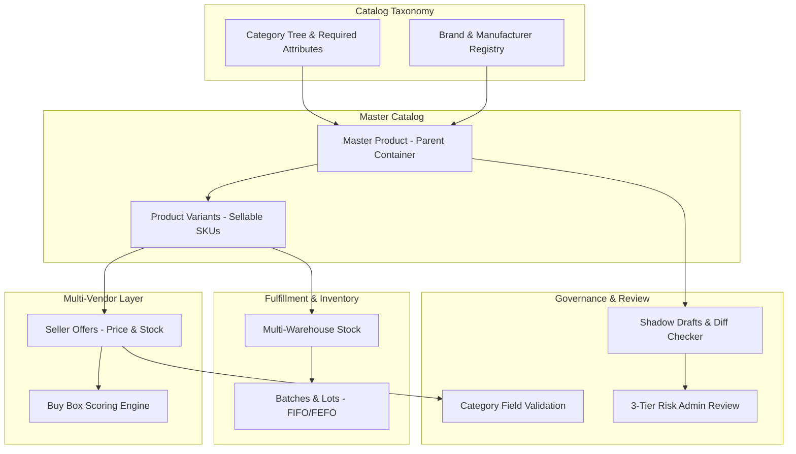
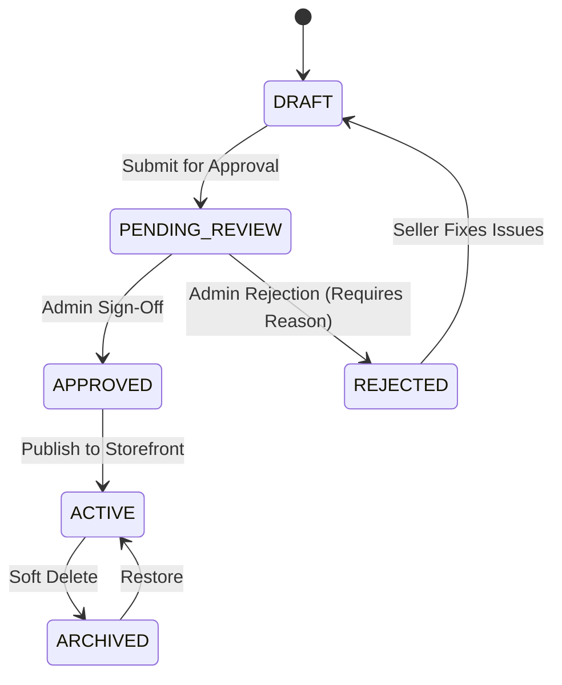

# Enterprise E-Commerce Product Architecture & Implementation Requirements (2026 Edition)

> **Document ID:** `GEMINI-REQ-2026-10-28`  
> **Target System:** Shopnetic Marketplace Engine (`apps/api`, `packages/contracts`, `packages/db`, `apps/admin`, `apps/storefront`)  
> **Scope:** Unified Product, Catalog, Inventory, Pricing, Governance, and Discovery Architecture  
> **Status:** Final Architectural Specification (Consolidated & De-duplicated)

---

## Executive Summary

Building a resilient, enterprise-scale multi-vendor marketplace (modeled after Amazon, eBay, and Shopify Plus) requires moving far beyond flat product database tables. A single product listing on the storefront is the synthesis of multiple bounded domains: an abstract master product container, concrete sellable SKU variants, category-governed dynamic attributes, competing multi-vendor offers, distributed warehouse inventories, batch-tracked lots, dynamic pricing tiers, and strict governance approval workflows.

This specification unifies the functional and technical requirements for the complete product lifecycle into 12 coherent, non-duplicative architectural domains with concrete database models, backend service pipelines, state machines, and reactive frontend components.



---

## 1. Core Structural Hierarchy: Master Product & Sellable Variant Models

Enterprise marketplaces enforce a strict two-tier separation between the abstract product identity and concrete sellable inventory units.

### 1.1 Master Product (The Parent / Container)
The master product acts as an immutable umbrella container grouping all variations together under a unified catalog entry. It is never directly purchased.
* **Metadata Scope:** Global Product Title, Brand Association (`brand_id`), Primary Category Tree Mapping (`category_id`), Global Markdown/Rich-Text Description, Global Barcode/GTIN/UPC guidelines, Compliance/Safety Documents, and Base Media Guidelines.
* **Invariants:** 
  - A master product cannot be added directly to the shopping cart.
  - Deleting or archiving a master product cascades a soft-archive flag down to all underlying variants and active offers.
  - Master products carry an overall lifecycle status (`DRAFT`, `PENDING_REVIEW`, `ACTIVE`, `REJECTED`, `ARCHIVED`).

### 1.2 Product Variant (The Child / Sellable Unit - SKU)
The variant represents the physical or digital item a customer selects and purchases.
* **Metadata Scope:** Unique Stock Keeping Unit (`sku`), GTIN/Barcode (UPC, EAN, ISBN), Physical Dimensions (Length $\times$ Width $\times$ Height in mm), Physical Weight (in grams), Option Combination Signature (`comboSignature`), and Variant-Specific Image Chips.
* **Standardized Measurement Units:**
  - **Discrete Units:** Single pieces (`PIECE`), sets, multi-packs (`PACK`).
  - **Continuous Units:** Weight-based (`WEIGHT_KG`, `WEIGHT_LB`), volume-based (`VOLUME_LITER`, `VOLUME_ML`), or length-based (`LENGTH_M`) to compute unit prices (e.g., "$2.50 / 100g") required by consumer protection laws.

### 1.3 Relational Schema Blueprint (PostgreSQL / Prisma)

```prisma
model MasterProduct {
  id              String         @id @default(uuid())
  title           String
  slug            String         @unique
  categoryId      String         @map("category_id")
  brandId         String?        @map("brand_id")
  descriptionHtml String?        @map("description_html")
  complianceDoc   Json?          @map("compliance_doc")
  status          ProductStatus  @default(DRAFT)
  createdAt       DateTime       @default(now()) @map("created_at")
  updatedAt       DateTime       @updatedAt @map("updated_at")
  archivedAt      DateTime?      @map("archived_at")

  variants        ProductVariant[]
  options         ProductOption[]
  media           ProductMedia[]
  shadowDrafts    ProductShadowDraft[]

  @@map("catalog_master_product")
}

model ProductVariant {
  id              String         @id @default(uuid())
  masterProductId String         @map("master_product_id")
  sku             String         @unique
  gtin            String?        @unique
  comboSignature  String         @map("combo_signature") // e.g., "color:black|size:xl"
  weightG         Int            @default(0) @map("weight_g")
  lengthMm        Int?           @map("length_mm")
  widthMm         Int?           @map("width_mm")
  heightMm        Int?           @map("height_mm")
  unitType        UnitType       @default(PIECE) @map("unit_type")
  createdAt       DateTime       @default(now()) @map("created_at")
  updatedAt       DateTime       @updatedAt @map("updated_at")

  masterProduct   MasterProduct  @relation(fields: [masterProductId], references: [id], onDelete: Cascade)
  offers          SellerOffer[]
  warehouseStock  WarehouseInventory[]
  batches         WarehouseBatch[]

  @@unique([masterProductId, comboSignature])
  @@map("catalog_product_variant")
}
```

---

## 2. Dynamic Attribute Catalog & Multi-Dimensional Option Matrices

Categories dictate product traits. The system combines flexible catalog-wide Option Types with dynamic Category Attribute Definitions (EAV / JSONB) to avoid schema migrations when onboarding new product verticals.

### 2.1 Multi-Dimensional Variant Axes (Cartesian Matrix Engine)
* **Single-Dimension Options:** Products varying along a single axis (e.g., Capacity: 64GB, 128GB, 256GB).
* **Multi-Dimension Cartesian Product:** Products varying across multiple axes (e.g., `Color [Black, Navy]` $\times$ `Size [S, M, L]` $\times$ `Material [Cotton, Linen]`).
  - The variant generation service computes the mathematical Cartesian product.
  - Automatically generates SKUs and combination signatures (`comboSignature = "color:black|material:cotton|size:m"`).
  - Allows merchants to deactivate or prune non-existent physical combinations (e.g., "Linen" is not offered in "Navy-Small") without corrupting the mathematical matrix.

### 2.2 Category-Scoped Dynamic Attributes (Informational EAV/JSONB)
* Categories define required and optional attribute schemas (e.g., Laptops require `ram_gb`, `cpu_model`, `storage_type`; Apparel requires `fabric_care`, `neckline`, `fit_type`).
* Validated against dynamic Zod/JSON schemas tied to the category ID.
* Stored in structured JSONB columns with GIN indexing for fast faceted filtering.

### 2.3 Customizable & Personalized Attributes
* Pre-cart configuration attributes that do not generate distinct SKUs (e.g., custom laser engraving text on a watch back, custom photo upload for canvas printing).
* Validated at the Cart API perimeter and preserved on the order line item.

---

## 3. Multi-Vendor Offer Architecture & Algorithmic Buy Box Engine

Unlike single-merchant storefronts, Shopnetic permits multiple independent vendors to sell the identical product variant under a single master listing.

### 3.1 The Seller Offer Model
Multiple merchants bind their independent inventory, pricing, and fulfillment guarantees to a single `ProductVariant` SKU:
* **Offer Attributes:** Seller ID, Variant ID, Listing Price, Compare-At Price, Stock Quantity, Item Condition (`NEW`, `REFURBISHED_LIKE_NEW`, `REFURBISHED_GOOD`, `USED`), Shipping SLA (estimated handling + transit days), and Return Window.

### 3.2 Algorithmic Buy Box Scoring Engine
When a buyer views a product page, the Buy Box engine dynamically scores all active, in-stock seller offers in real time and assigns the primary "Add to Cart" button to the highest-scoring merchant:

$$\text{BuyBoxScore} = (w_p \cdot P_{\text{score}}) + (w_s \cdot S_{\text{score}}) + (w_r \cdot R_{\text{score}}) - (w_d \cdot D_{\text{penalty}})$$

Where:
* $P_{\text{score}}$: Price competitiveness relative to lowest active offer.
* $S_{\text{score}}$: Fulfillment speed and delivery SLA reliability.
* $R_{\text{score}}$: Seller historical feedback rating (1–5 stars).
* $D_{\text{penalty}}$: Order Defect Rate (ODR) and cancellation rate penalty.

### 3.3 Secondary Offers ("Other Sellers" Interface)
Offers that do not win the Buy Box remain accessible via an expandable drawer/accordion on the product page, allowing buyers to compare alternate merchant conditions, prices, and shipping speeds.

---

## 4. Packaging, Fulfillment Classes & Special Product Types

Products must be classified by their physical nature, delivery constraints, and fulfillment handling:

| Product Class | Physical Inventory? | Dimensions & Weight Required? | Fulfillment Handling |
| :--- | :--- | :--- | :--- |
| **Standard Physical** | Yes | Yes (L $\times$ W $\times$ H, Weight) | Standard parcel logistics, automated cubic rate quoting. |
| **Bulky / Freight** | Yes | Yes (Volumetric & Heavy metrics) | LTL (Less-Than-Truckload) freight, tailgate lift, scheduled delivery window. |
| **Digital & Virtual** | No | No | Bypasses warehouse allocation; generates instant digital key, download link, or license entitlement upon payment. |
| **Service & Warranty** | No | No | Logical attachment to physical SKU (e.g., "3-Year Protection Plan", "Installation Service"); fulfilled via service voucher or schedule booking. |
| **Bundles & Kits** | Virtual | Derived from components | Multi-SKU atomic decrement: bundles do not have distinct physical stock; buying a bundle atomically reserves 1 unit from each individual component SKU. |
| **Multi-Packs** | Yes | Yes | A discrete SKU mapped to a multiplier of a base item (e.g., Pack of 6), tracked via its own manufacturer GTIN. |

---

## 5. Multi-Warehouse Stock Allocation, Batch/Lot Tracking & Expiry (FIFO/FEFO)

Real-world physical supply chains require multi-location stock visibility and batch-level traceability.

### 5.1 Multi-Warehouse Stock Allocation
* A single variant SKU has distinct stock counts across multiple physical facilities:
  - `onHand`: Total physical units in warehouse.
  - `allocated`: Units locked in active checkout or unfulfilled orders.
  - `available`: Real-time sellable units (`onHand - allocated`).
  - `safetyStock`: Configurable buffer reserved offline to prevent overselling.

### 5.2 Batch, Lot & Expiry Management (`warehouse_batches`)
Essential for food, health, cosmetics, and pharmaceuticals:
* Each inbound shipment receives a batch record tracking:
  - `batchNumber`: Manufacturer lot code.
  - `expiryDate`: Product expiration date.
  - `manufactureDate`: Production date.
  - `unitCostPrice`: Inbound wholesale cost.
  - `currentQty`: Remaining sellable quantity in this specific lot.

### 5.3 Order Allocation Sequencing (FIFO / FEFO)
When orders are fulfilled, the inventory service determines the exact batch to pick:
* **FEFO (First-Expired, First-Out):** Automatically allocates units from the batch with the nearest expiration date (`expiryDate ASC`), minimizing inventory spoilage.
* **FIFO (First-In, First-Out):** For non-perishable goods, allocates from the oldest received batch (`receivedAt ASC`).
* **Financial COGS:** Directly ties order fulfillment to the batch's `unitCostPrice` for accurate Cost of Goods Sold and gross margin reporting.

---

## 6. Dynamic Pricing Matrix, Volume Tiers (B2B) & Promotional Engine

Price is an expressive matrix computed authoritatively on the backend.

### 6.1 Pricing Dimensions
* **Base Price vs. Compare-At Price (MSRP):** Powers storefront strike-through display (e.g., ~~$120.00~~ **$89.99**).
* **Tiered / Wholesale (B2B) Volume Brackets:** Quantity-based price breaks configured per offer:
  - `1–9 units`: $15.00/unit
  - `10–49 units`: $12.50/unit
  - `50+ units`: $9.75/unit
* **Customer Segment Overrides:** VIP memberships, trade accounts, or employee discounts.
* **Geographic & Currency Localization:** Country-specific price overrides and rounded multi-currency conversions.
* **Scheduled Flash Sales:** Time-bound promotional pricing with automated start and expiration reversion timestamps.

### 6.2 Authoritative Server-Side Price Resolution
The frontend never submits prices. The Cart & Checkout services resolve price authoritatively at the API boundary by querying active seller offers, evaluating volume tiers against line item quantities, and validating promo code expiry in a single transaction.

---

## 7. Media Asset Pipeline & Variant Gallery Tagging

High-converting product listings demand rich, validated media distributed through low-latency CDNs.

### 7.1 Ingestion & Processing Pipeline
* **Asset Types:** Images (JPEG, PNG, WebP, AVIF), 360-Degree Spin sequences, and MP4/HLS Demo Videos.
* **Validation Perimeter:** Strict MIME-type sniffing, maximum file size enforcement (images $\le$ 15MB, videos $\le$ 250MB), and minimum resolution requirements (e.g., minimum 1000 $\times$ 1000 px for high-zoom image compliance).
* **Automated Transformations:** Asynchronous generation of thumbnails (`150x150`), gallery cards (`600x600`), and high-res zoom viewports (`1600x1600`).

### 7.2 Variant & Swatch Asset Tagging
* Media assets support optional tagging with specific variant option values (e.g., `option_value_id = "color_red"`).
* When a buyer clicks the "Red" color swatch on the storefront, the UI gallery dynamically transitions to display only photos matching the Red option tag, falling back to global master photos if no tag is assigned.

---

## 8. Governance, Category Validation & Multi-Tier Admin Review State Machine

To prevent catalog degradation and fraudulent updates while maintaining operational velocity, Shopnetic implements a risk-tiered governance engine.

### 8.1 Category-Specific Required Fields Engine
Before any product can leave `DRAFT` status, dynamic category validation rules run:
* If category is *Electronics*, the API validator enforces `voltage`, `wattage`, and `warranty_months`.
* If category is *Apparel*, it enforces `size_chart_id`, `fabric_composition`, and `care_instructions`.
* If category is *Cosmetics*, it enforces `ingredient_list` and `safety_certificate_url`.

### 8.2 Product Lifecycle State Machine



### 8.3 Shadow Draft Versioning Pattern
When a merchant modifies an already `ACTIVE` product:
1. The live product record remains completely untouched and purchasable on the public storefront.
2. The mutation writes a new record to `catalog_product_shadow_draft` storing the proposed delta.
3. The diff engine classifies the changes into risk tiers:

| Sensitivity Tier | Fields Covered | Processing Action |
| :--- | :--- | :--- |
| **Tier 1 (Safe)** | Stock quantity updates, secondary media additions, search tags. | **Auto-Approved:** Instantly merged to live product; audit event logged. |
| **Tier 2 (Moderate)** | Non-critical description edits, weight/dimension corrections. | **Async Notification:** Merged to live; queued for post-publish staff audit. |
| **Tier 3 (Critical)** | Price spikes (>25%), Product Title, Brand, Category, Primary Barcode (GTIN), Compliance Certifications. | **Hard Block:** Live product stays unchanged; shadow draft routed to Admin Review Moderation Queue (`PENDING_REVIEW`). Merges only upon staff approval. |

---

## 9. Search Engine Indexing, BM25 Scoring & Dynamic Faceting

Relational databases cannot support instant, typo-tolerant, faceted searches across millions of SKUs.

### 9.1 Asynchronous Search Index Synchronization
* Database mutations emit domain events (`catalog.product.published`, `catalog.product.updated`, `catalog.offer.price_changed`) to message queues (BullMQ / Redis / Kafka).
* Search indexing workers ingest events, denormalize relational structures into a flat search document, and push to Elasticsearch / OpenSearch.

### 9.2 Multi-Factor Search Ranking Algorithm
Search queries calculate relevance scores using **Okapi BM25** augmented with commercial marketplace ranking factors:

$$\text{FinalScore} = (\text{BM25}_{\text{Text}} \cdot 0.35) + (\text{SalesVelocity}_{\text{30d}} \cdot 0.25) + (\text{SellerRating} \cdot 0.15) + (\text{ConversionRate} \cdot 0.15) + (\text{InStockBoost} \cdot 0.10)$$

### 9.3 Dynamic Facets & Multi-Token Filtering
* Instant aggregated bucket counts for Brands, Categories, Price Ranges, and Dynamic Option Values.
* Typo-tolerant fuzzy searching with synonym mapping (e.g., "sneaker" maps to "running shoe").

---

## 10. Verified Purchase Reviews, Customer Q&A & Community Moderation

Trust and social proof drive conversion while preventing fraudulent feedback loops.

### 10.1 Verified Purchase Gating
* **Anti-Fraud Hook:** The review creation endpoint cross-references `order_items` and `orders` to confirm the authenticated `buyer_id` actually completed an order containing that specific `product_id` and that the order status is `DELIVERED`.
* Unverified customers are prohibited from submitting star ratings.

### 10.2 Review Architecture
* Star rating (1 to 5), verified buyer badge, customer photo and video uploads, and attribute-specific feedback (e.g., sizing accuracy: "Runs Small", "True to Size", "Runs Large").
* Helpful voting system (`helpful_count`, `unhelpful_count`) to bubble high-value community reviews to the top.

### 10.3 Customer Q&A Module
* Community Q&A forum on product pages allowing prospective buyers to ask questions answered by verified past purchasers or the verified merchant.

---

## 11. Related Product Algorithms & Semantic Vector Recommendations

Maximizing Average Order Value (AOV) requires real-time algorithmic cross-selling.

### 11.1 Collaborative Filtering (Transaction Association)
* Scheduled batch pipelines compute co-purchase frequency matrices across historical order data:
  - **"Frequently Bought Together":** High-confidence association rules ($X \implies Y$ with high support/lift), displayed with single-click "Add Bundle to Cart".
  - **"Customers Who Bought This Also Bought":** Second-degree co-purchase recommendations.

### 11.2 Semantic Vector Embeddings (`pgvector`)
* Generate 768-dimensional vector embeddings from product titles, categories, and descriptions.
* Compute Cosine Similarity distance in real time:
  $$\text{Similarity}(A, B) = \frac{A \cdot B}{\|A\| \|B\|}$$
* Powers "Visually Similar Products" and "Alternative Recommendations" when the primary item is out of stock.

---

## 12. Frontend Component Architecture & Reactive UX Patterns

Frontend client applications (`apps/storefront`, `apps/admin`) project and cache server data with strict UI states.

### 12.1 Dynamic Variation Matrix Selector
* A high-performance reactive component tracking selected option state:
  - Evaluates user clicks (e.g., user selects "Color: Navy").
  - Dynamically recalculates valid and in-stock combinations in the variant matrix.
  - Visually disables or strikethroughs unavailable option buttons in real time (e.g., disabling "Size: XL" if Navy-XL is out of stock across all sellers).

### 12.2 Buy Box & Alternative Sellers Interface
* **Primary Buy Box:** Renders winning seller name, badge, price, delivery guarantee, and primary CTA.
* **Secondary Offers Drawer:** Expandable sheet showing other qualified merchant offers sorted by price and delivery speed.

### 12.3 High-Zoom Variant Media Gallery
* Dynamic carousel that seamlessly updates its image collection when the active variant option switches.
* Supports pinch-to-zoom, desktop cursor pan-zoom, and embedded customer review media.

---

## 13. Comprehensive Implementation & Readiness Matrix

This matrix tracks the mapping of these 12 architecture points into the Shopnetic codebase:

| Architectural Domain | Core Entities / Tables | Backend Services | Frontend Components | Implementation Status in Monorepo |
| :--- | :--- | :--- | :--- | :--- |
| **1. Structural Hierarchy** | `MasterProduct`, `ProductVariant` | `ProductService`, `VariantService` | `ProductList`, `ProductFormModal` | **Implemented** (`apps/api/src/catalog/`, `apps/admin/`) |
| **2. Dynamic Option Matrices** | `OptionType`, `OptionValue`, `CategoryOption` | `CategoryOptionService`, `VariantGenerator` | `ProductOptionsDialog`, `ProductVariantsDialog` | **Implemented** (`apps/api/src/catalog/`, `apps/admin/`) |
| **3. Multi-Vendor Offers & Buy Box** | `SellerOffer`, `BuyBoxScore` | `OfferService`, `BuyBoxEngine` | `ProductOffersDialog`, `BuyBoxCard` | **Phase 1 Implemented** (Seller Portal + Admin Offers) |
| **4. Packaging & Fulfillment Classes** | `ProductVariant.dims`, `ProductClass` | `FulfillmentClassifier`, `RateCalculator` | `VariantDimensionsForm` | **Implemented** (Dims > 0 validated, classes mapped) |
| **5. Multi-Warehouse & Batches** | `WarehouseInventory`, `WarehouseBatch` | `InventoryService`, `BatchAllocationService` | `StockAdjustModal`, `BatchTable` | **Warehouse Implemented**; Batches / FEFO Planned (Phase 3) |
| **6. Dynamic Pricing Matrix** | `PriceTier`, `CurrencyOverride` | `PricingResolutionService` | `TieredPricingTable` | **Base Implemented**; B2B Volume Tiers Planned (Phase 2) |
| **7. Media Pipeline & Tagging** | `ProductMedia`, `MediaTag` | `MediaService`, `AssetProcessor` | `ProductMediaDialog` | **Implemented** (`apps/api/src/catalog/media.service.ts`) |
| **8. Governance & Shadow Drafts** | `ProductShadowDraft`, `AuditEvent` | `ProductService.approve()`, `DiffChecker` | `AuditLogDiffModal`, `ReviewQueue` | **Review Lifecycle Implemented**; Shadow Drafts Planned (Phase 2) |
| **9. Search & Faceting** | `SearchIndexDoc`, Elasticsearch | `SearchIndexerWorker`, `SearchService` | `FacetedFilterBar`, `SearchInput` | **Stub Ready** (`apps/search-indexer/`, `apps/api`) |
| **10. Verified Reviews & Q&A** | `ProductReview`, `ReviewVote` | `ReviewService`, `OrderVerificationHook` | `ReviewSection`, `VerifiedBadge` | **Planned** (`plan/12-reviews-ratings.md`) |
| **11. Related Product Algorithms** | `ProductRecommendation`, `pgvector` | `RecommendationService` | `RelatedProductsCarousel` | **Planned** (`plan/28-search-recommendations.md`) |
| **12. Frontend Component UX** | UI Design System | TanStack Query, React Server Components | `@shopnetic/ui` Primitives | **Implemented** (Zero Radix leaks, full keyboard & A11y) |

---

*This document is the authoritative functional and technical requirements reference for Shopnetic product catalog development. When extending or modifying features, preserve single sources of truth, contract-first Zod schemas, and strict audit logging.*
